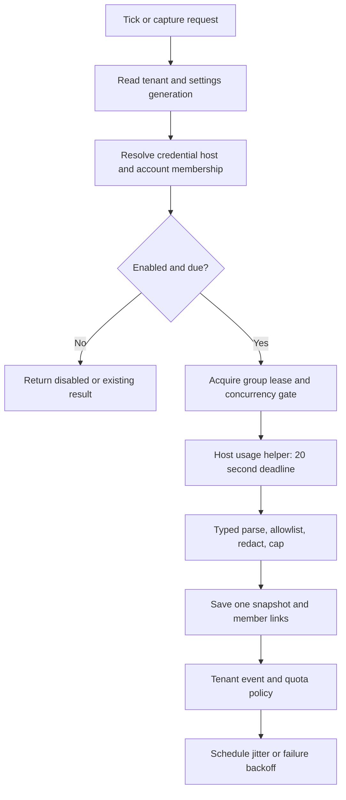
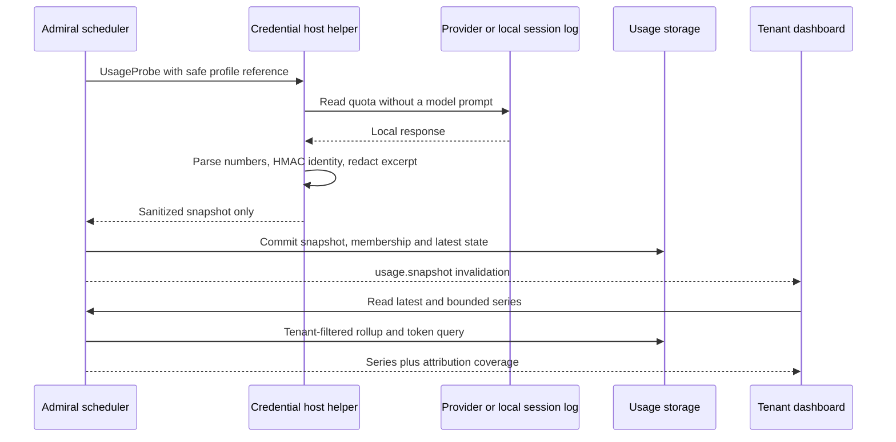
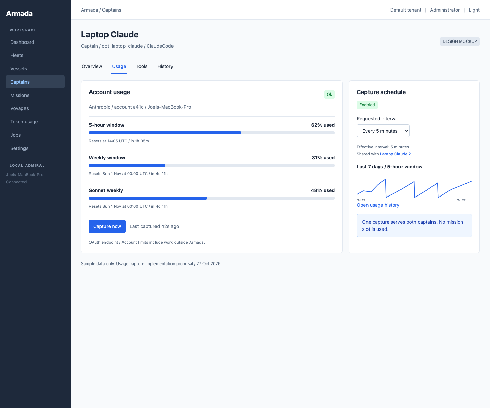
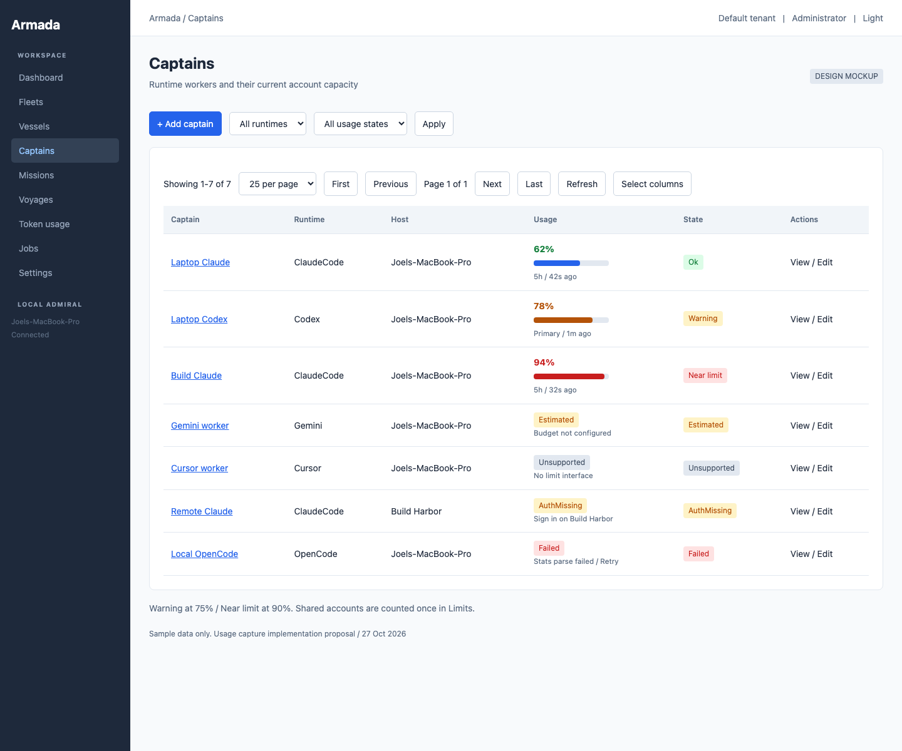
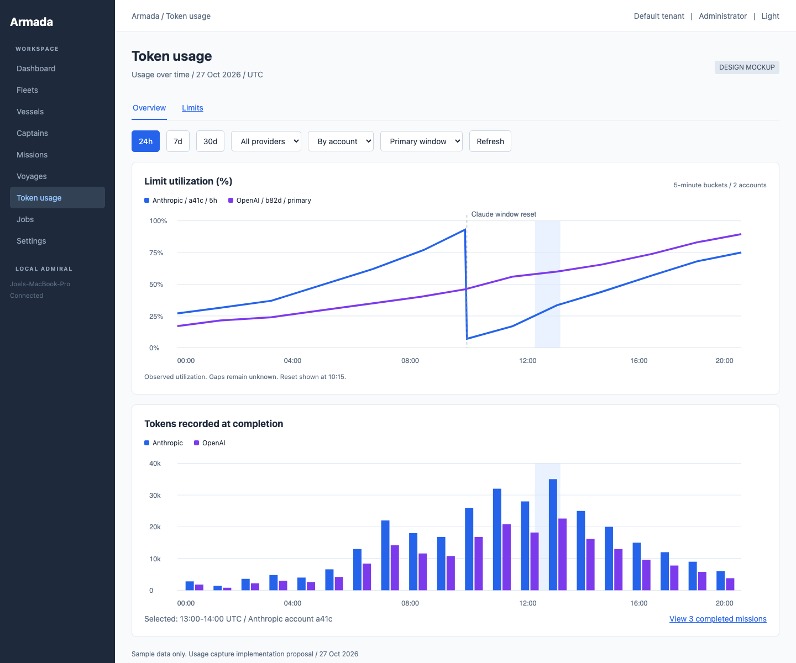
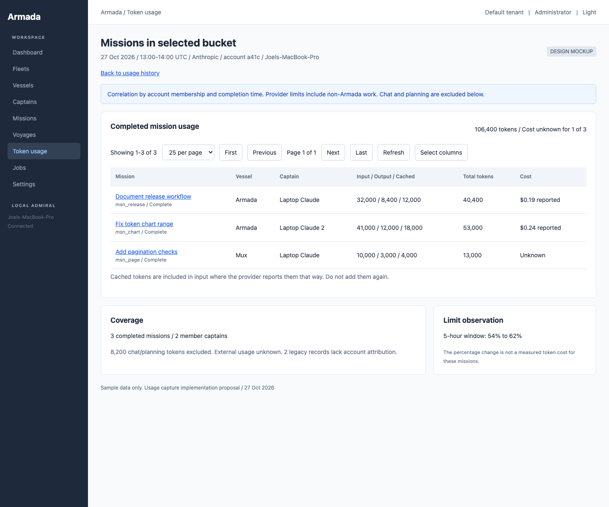
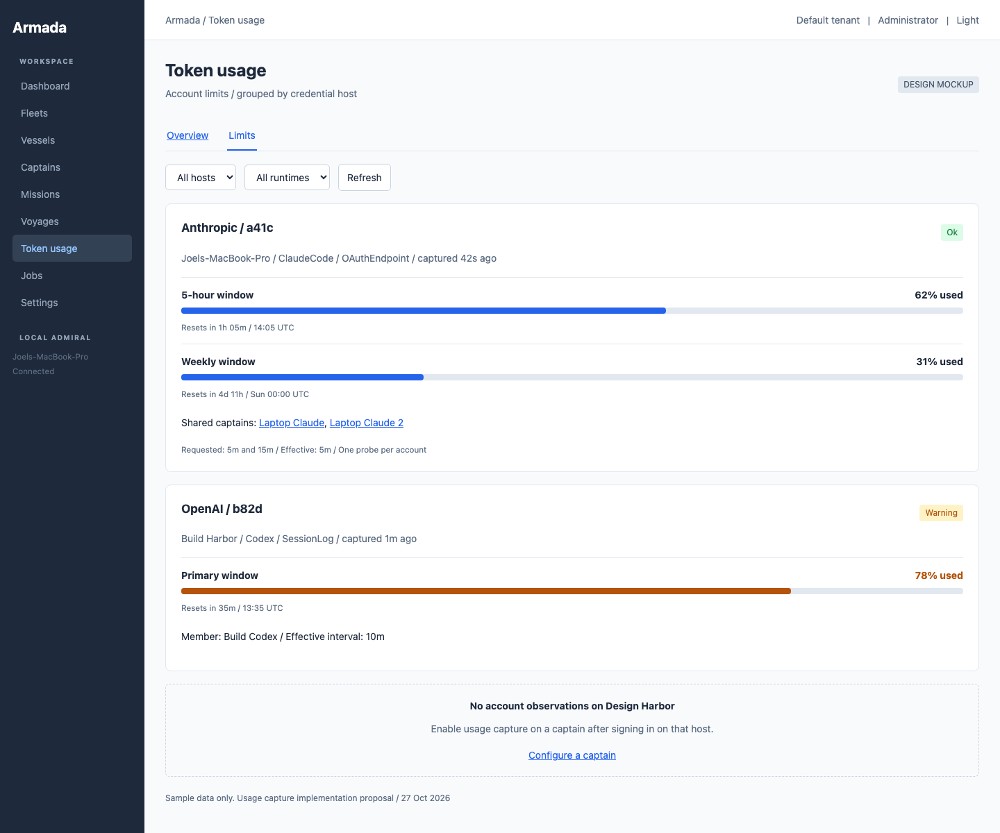
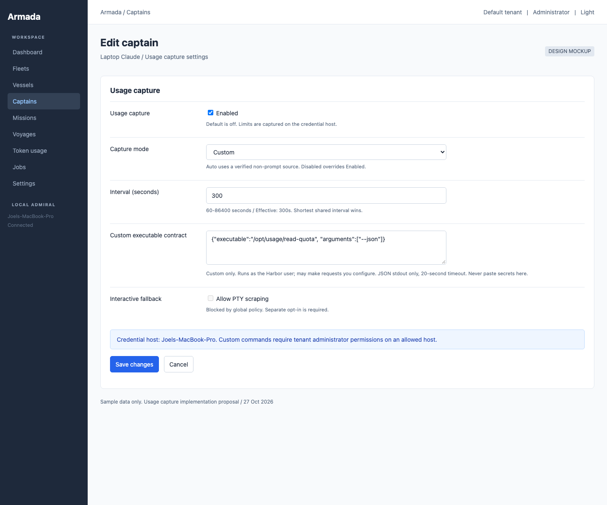
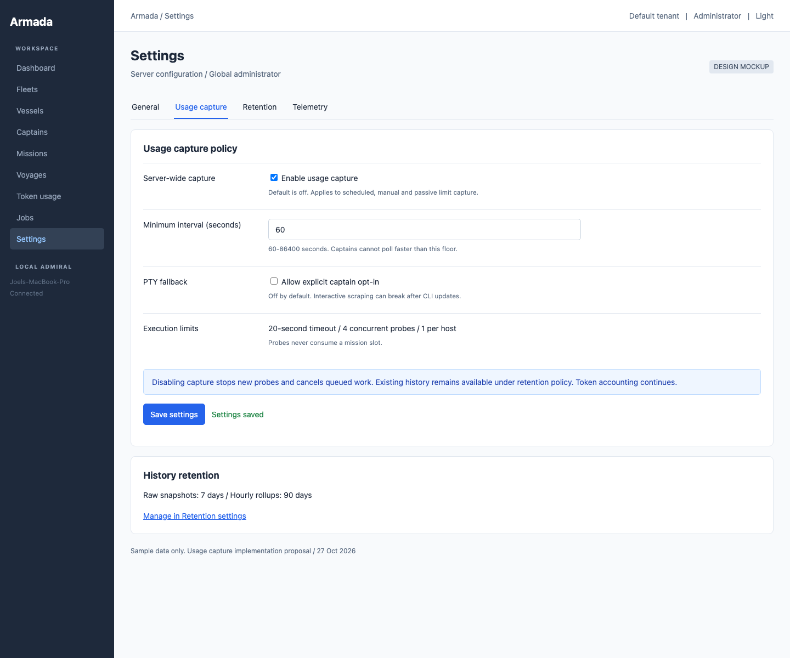

# Captain usage capture and account limits

Armada should show whether a captain can work before dispatching another mission. Token totals answer how much work Armada recorded. Account limits answer how much capacity the provider currently permits. Keep both, with their source and age visible.

Status: implementation proposal, based on repository commit `b2bb919898b91dc12370b9f71f0d60cff2ca1595`, inspected 2026-10-27. No product behavior changes in this mission. All screenshots use invented sample data. Provider interfaces remain subject to the version spike in phase 0; no authenticated provider probes were run for this plan.

## Verified baseline and decisions

`src/Armada.Core/Enums/AgentRuntimeEnum.cs` defines exactly ClaudeCode, Codex, Gemini, Cursor, Mux, OpenCode, ApiEndpoint, and Custom. Cover all eight rather than equating runtime with provider. OpenCode, Mux, Custom, and ApiEndpoint can each use several providers.

`src/Armada.Core/Models/TokenUsageRecord.cs` records input, output, cached and total tokens, runtime, model, tenant, user, captain, vessel, harbor, source and source ID at completion. Sources include mission, chat and planning. Counts may be estimated. There is no cost, provider, account key, start timestamp or per-token timestamp. `src/Armada.Core/Services/TokenUsageCapture.cs` persists those records best effort. `ClaudeMissionStreamDecoder.cs` and `CodexMissionStreamDecoder.cs` in that directory decode mission output; they are not account-limit collectors. Claude's decoder explicitly ignores rate-limit events as transcript text. Extend typed protocol parsing without injecting limit events into transcripts.

`src/Armada.Dashboard/src/pages/TokenUsage.tsx` and `src/Armada.Server/Routes/TokenUsageRoutes.cs` already expose token history and summaries. Extend that page with a Limits tab and provider history, preserving its existing filters and charts. `src/Armada.Core/Services/ProviderResetParser.cs` reads structured error reset/retry-after values for quarantine, accepts only future times within 24 hours, and does not search arbitrary text. Weekly quota reset timestamps need their own validated parser, not a widened error-parser policy. `RuntimeProviderErrorParser.cs` recognizes Gemini RESOURCE_EXHAUSTED; a reliable reset is not guaranteed.

| Decision | Implementation choice and reason |
|---|---|
| D1: ownership | Limit snapshots belong to an account on a host. Deduplicate on tenant + stable host identity + runtime + hashed account key. Tenant is an isolation boundary even when credentials happen to be shared. Captain is a subscriber, not the owner. |
| D2: settings storage | Add explicit Captain columns. The four settings are a fixed, validated cross-runtime contract queried by the scheduler and presented in all clients. `Captain.RuntimeOptionsJson` stays adapter-specific. Explicit columns avoid silent JSON merge loss and follow the relational-contract guidance in `CLAUDE.md`. |
| D3: defaults | Enabled=false; interval=300 seconds, clamped to 60..86400; mode=Auto; command=null. Disabled mode always wins. Auto and Custom also require Enabled=true. Old and minimally deserialized captains stay disabled. |
| D4: source policy | Auto uses only verified read-only sources with no model prompt. PTY requires separate explicit opt-in, never an automatic fallback. Custom is an administrator-chosen local executable contract. |
| D5: attribution | Associate snapshots and token records through effective-dated captain/account/host membership. Display mission consumption by completion bucket. Do not call a quota percentage delta mission token consumption. |
| D6: quarantine | Only fresh authoritative exhausted windows affect routing. Estimated, stale, failed, unsupported and missing-auth data never quarantine or release a captain. Clear only quota-owned quarantine, never manual, health or administrative holds. |
| D7: retention | Preserve raw snapshots and sanitized excerpts for 7 days; retain hourly rollups for 90 days. Preserve bounded latest-state metadata separately so an idle account does not look newly captured. Token retention independently bounds drill-down. |
| D8: cost | Add nullable reported cost/currency and provider attribution to token records during implementation. Missing cost remains unknown. Optional versioned price-catalog estimates must be labeled Estimated and never converted into subscription charges. |

`DECISIONS.md` documents existing API parity gaps and cancellation problems. Do not repair unrelated routes here. New capture operations must share service validation and authorization across REST and MCP; new Jobs cancellation must really terminate its own probe process. Existing WebSocket commands require global admin. Add a tenant-scoped event, not a new command that bypasses REST permissions.

## Capture settings and host identity

Expose `UsageCaptureEnabled`, `UsageCaptureIntervalSeconds`, `UsageCaptureMode` (Auto|Disabled|Custom), and nullable `UsageCaptureCommand` on captain create/update/read DTOs. Clear the command when leaving Custom. Preserve omitted fields on metadata updates; distinguish missing from explicit null. Reject unknown enum strings, negative/malformed types and Custom without a command; normalize numeric interval bounds consistently in model setters and APIs, returning the effective value. Document the clamping in OpenAPI and the form.

Add `UsageCaptureSettings` under `ArmadaSettings.UsageCapture`: Enabled=false, MinimumIntervalSeconds=60 (60..86400), AllowPtyFallback=false, ProbeTimeoutSeconds=20, MaximumConcurrentProbes=4, MaximumConcurrentProbesPerHost=1, MaximumBackoffSeconds=3600, MaximumExcerptBytes=2048 and configurable raw/rollup days (7/90). The global switch disables scheduled and manual active probes and passive limit persistence. Existing token recording continues. A captain's Disabled mode opts it out of limit capture and membership. Changing settings cancels queued work, invalidates its scheduling generation and recomputes groups immediately.

Resolve a stable Admiral host ID or Harbor ID before any credential lookup. Captain has no direct HarborId field in the inspected model. Use existing routing/host resolution, including `DockHostResolver.cs`, `VesselHostResolver.cs`, captain runtime options and Harbor affinity. A movable captain can have memberships on several hosts; show the host explicitly and schedule only on its resolved execution host. No host resolution means Failed/HostUnavailable, never a fallback to the Admiral's credentials.

On the credential host, derive an opaque account identity from provider-issued account/organization identity and active credential profile, then HMAC-SHA256 it with a host-local protected stable key and tenant namespace. Do not hash access tokens: token rotation must not create a new account. Neither email nor raw account IDs leave the host. Persist the HMAC key through host restarts; key loss creates a new identity and closes the old membership. Missing identity must not merge unrelated captains into an 'unknown' group. Show AuthMissing or IdentityUnavailable, and suspend polling until credentials/configuration change or a slow retry is due.

Groups use the shortest requested interval among enabled members, bounded by the global minimum. For intervals 300 and 900 with a global minimum of 600, both share a 600-second group. Display requested and effective intervals. Custom commands with different executable/configuration identities must not share results merely because they return the same account key; include a command fingerprint in the probe configuration discriminator. Provider identity changes invalidate membership before the next observation.

## Provider and harness metrics matrix

Confidence labels describe the source, not guaranteed availability on every installed version: Official means a documented vendor interface, Undocumented means an internal endpoint or local format, Estimated means Armada calculation with incomplete coverage, and Unavailable means no verified source. A blank number is unknown, never zero. The matrix separates subscription limits from harness accounting; 'session' is not a quota window.

| Runtime / provider mode | Session or 5h utilization | Weekly utilization | Per-model utilization | Reset times | Tokens in/out/cached | Cost | Requests/minute or day | Remaining tokens | Plan/tier | Source and confidence |
|---|---|---|---|---|---|---|---|---|---|---|
| ClaudeCode / subscription OAuth | 5h when returned | 7d when returned | Named model windows when returned | `resets_at` per window | Existing stream accounting; cache when supplied | Reported run cost if supplied; subscription bill unavailable | Unavailable | Unavailable from percent alone | Credential/profile hint only, not authoritative | OAuth usage endpoint: Undocumented; interactive `/usage`: Official UI, Undocumented scrape |
| ClaudeCode / API key | Unavailable subscription quota | Unavailable | Unavailable | Header/error reset only if exposed | Existing accounting | Nullable reported or Estimated catalog cost | Headers if surfaced, not assumed in CLI | Header token budget if exposed | Unavailable | Tokens: harness source; provider headers: Official per provider, conditional |
| Codex / ChatGPT | Primary window, duration returned, not hardcoded 5h | Secondary if duration indicates weekly | Separate limit IDs when supplied; no assumed model mapping | Absolute app-server `resetsAt`; relative session variants | Existing turn usage, cache conditional | Subscription bill unavailable | Unavailable | Unavailable from percent alone | `planType` if returned | App-server: Official; session JSONL and PTY scrape: Undocumented |
| Codex / API key | Unavailable subscription quota | Unavailable | Unavailable | Conditional provider headers/errors | Existing accounting | Nullable reported/Estimated | Conditional headers | Conditional headers | Unavailable | No subscription polling; headers only when transport exposes them |
| Gemini / Google login or API | Estimated configured daily/request budget, not 5h | Unavailable | Estimated only with model-specific configured budgets | Configured boundary Estimated; exhaustion reset if explicit | Existing TokenUsageRecord, may be Estimated | Nullable reported/Estimated | Estimated only if actual request counts exist; token records are not request counts | Estimated only against a configured token budget | Operator-configured tier, not detected | `/stats` session totals only; Derived: Estimated; errors: observed exhaustion |
| Cursor / configured provider | Unavailable | Unavailable | Unavailable | Structured rejection only | Existing token accounting, may be Estimated | Unavailable unless reported | Unavailable | Unavailable | Unavailable | No verified account limit interface: Unavailable; retain extension hook |
| OpenCode / configured provider | Session totals, not limit % | Unavailable | Token/cost breakdown, not quota % | Provider rejection only | `opencode stats` and existing records; cache conditional | Local stats reported/estimated by harness | Unavailable | Unavailable | Unavailable | Stats command: Official; output parser: versioned; account limits Unavailable |
| Mux / configured endpoint | Per-run tokens, not limit % | Unavailable | Per-model usage, not quota % | Captured provider headers if instrumented | `run_completed.usage` / existing records | `costUsd` per run when present | Conditional provider transport headers | Conditional header budgets | Unavailable | Local Mux source verified; provider limits conditional, not a Mux stats command |
| ApiEndpoint / Anthropic | No subscription quota; request/token windows | Unavailable | Endpoint/model scopes if explicit | `anthropic-ratelimit-*` reset headers | Per-call response usage | Reported if supplied, else Estimated | Header request limits/remaining | Header token limit/remaining | Operator-configured only | Provider HTTP headers: Official; present calls only, no polling |
| ApiEndpoint / OpenAI-compatible | Header utilization only when denominator known | Unavailable | Scope only if documented | `x-ratelimit-*`, Retry-After | Per-call usage, cache conditional | Reported if supplied, else Estimated | Header request limits/remaining | Header token limits/remaining | Operator-configured only | Provider-specific headers: Official where documented; compatible servers may omit all |
| Custom / any provider | Contract-defined | Contract-defined | Contract-defined | Contract-defined UTC | Existing accounting or contract extension | Nullable contract extension | Contract-defined windows | Contract-defined windows | Optional sanitized label | Custom: operator asserted, Undocumented unless separately verified |

### Noteworthy gaps

A provider's account can also be used outside Armada. Snapshot utilization includes that external work; mission totals cannot explain all of it. Several captains can share one limit, so adding their percentages is wrong. Provider views default to distinct account series, with a named window selector. A provider summary may show the maximum utilization as 'Highest account utilization'; it must never sum or average unrelated percentages without saying so.

Gemini's public quota guide describes tiers, not a verified remaining-quota API for this integration. Token totals cannot reconstruct request-per-day use, especially with retries, chat, external CLI sessions or missing records. Only derive a percentage when a configured budget and matching counter unit exist; otherwise show Estimated with an explanation and no bar. Cursor has no verified limit capture path here. OpenCode statistics and Mux per-run usage are accounting, not remaining capacity. Account/host deduplication cannot identify the same subscription used on two different hosts; label that possible overlap and do not combine it into a purported global remaining balance.

Official documentation checked during planning: [Codex app-server](https://developers.openai.com/codex/app-server) documents account rate limits with window duration and reset timestamps; [OpenCode CLI](https://opencode.ai/docs/cli/#stats) documents session token/cost statistics; [Gemini quota guide](https://geminicli.com/docs/resources/quota-and-pricing/) describes quota policy; [Claude interactive reference](https://code.claude.com/docs/en/interactive-mode) distinguishes subscription resets from API billing. Those sources do not validate the proposed internal Claude OAuth endpoint or local JSONL variants. Local Mux evidence is `Mux/src/Mux.Cli/Program.cs` (--stats/--no-stats and usage telemetry setup) and `Mux/README.md` (contract v2 `run_completed.usage`, including costUsd), inspected in the sibling Mux vessel. No standalone stats command was found in that CLI dispatch. Recheck during phase 0.

## Probe framework and runtime adapters

Add optional `IUsageProbe.CaptureAsync(UsageProbeHost host, CancellationToken token)` returning a typed UsageSnapshot or Unsupported result. Host context includes tenant, stable host ID, runtime, safe profile reference and probe configuration; it never contains credential contents on the Admiral for remote hosts. Add `AgentRuntimeCapabilities.SupportsUsageCapture(runtime)` beside SupportsPlanningSessions, plus a richer capability descriptor (active, passive, estimated, unsupported and reason). Conditional capability does not promise credentials or quota support. Cursor returns false for built-in account capture; Custom is conditional on its command, ApiEndpoint is passive, and Gemini is estimated.

ClaudeCode should read the host's active OAuth credentials using the CLI-compatible OS store, call the endpoint the installed CLI uses (candidate `https://api.anthropic.com/api/oauth/usage`), and normalize five_hour, seven_day, per-model utilization and resets_at. Isolate endpoint/headers behind a versioned adapter verified in phase 0. Do not export credentials, refresh them on the server, or overwrite the CLI credential store. API-key mode returns Unsupported for subscription windows while retaining tokens. PTY `/usage` is optional and separate: slash commands do not operate as interactive commands in `-p` mode. Never send `/usage` as a model prompt.

Codex should initialize a local `codex app-server` JSON-RPC session on the credential host and call `account/rateLimits/read`, with no thread/turn creation. Prefer documented `usedPercent`, `windowDurationMins`, `resetsAt`, and multiple limit IDs; do not assume primary=5h or secondary=7d. The proposed session-log fallback tails bounded recent `~/.codex/sessions/**/*.jsonl` token_count records containing rate_limits.primary/secondary. Some versions use `used_percent`, `window_minutes`, `resets_in_seconds`; others use absolute timestamps or different names. Match a known versioned DTO and compute relative resets from the event time, never from polling time. Preserve the event's observed time. Reject stale/future/truncated rows and never scan/export prompts. Harvest equivalent fields from live mission events for free when actually emitted; current `codex exec --json` and saved-session formats are not interchangeable. Opt-in PTY `/status` is last resort.

Gemini uses Derived estimates only with explicitly configured tier budgets, units, reset timezone and source revision. `/stats` is session accounting, not remaining capacity. Parse RESOURCE_EXHAUSTED using RuntimeProviderErrorParser, keeping an exhausted-until only when the error actually supplies a valid reset. Do not fabricate a midnight reset or authoritative 100% from a generic error. Cursor returns Unsupported and a useful reason; leave a provider adapter hook. OpenCode may read local `opencode stats` for accounting context without adding cumulative totals again to TokenUsageRecord. Limits remain Unsupported unless its provider transport later exposes them.

Mux follows the ApiEndpoint approach where the actual HTTP transport is reachable: harvest allowlisted rate-limit response headers on existing calls. Its per-run stats supply usage/cost, not a quota poll. If Armada cannot see Mux's provider headers, report Unsupported rather than probing through a prompt. ApiEndpoint captures `anthropic-ratelimit-*`, `x-ratelimit-*` and Retry-After at its inference transport, including streamed response initial headers and errors. Interpret units, organization/model scope and absolute/relative times per provider. Absence is Unsupported, not AuthMissing. Do not schedule an active call. `ModelEndpointService.cs` is endpoint management, not proof that a cheap quota-only request exists; an optional cheap probe is enabled only after phase 0 proves a non-generative read-only operation for that provider. Health/model-evaluation prompts are ineligible. The inspected transport anchors are `src/Armada.Runtimes/ApiAgentRuntime.cs` (inference orchestration), `src/Armada.Core/Services/ModelEndpointClientFactory.cs` (PolyPrompt construction) and `ModelEndpointAuthHandler.cs` (DelegatingHandler seam). Add a separate allowlisted response-header handler around that transport rather than assuming PolyPrompt returns raw headers. Phase 0 must confirm its injected-client path covers every selected provider and streamed error response.

Custom runs a locally configured executable plus argument array represented by UsageCaptureCommand JSON, without shell interpolation. Only tenant administrators on permitted hosts may configure it; it runs as the existing Harbor service user, so the editor must make that authority explicit. The executable's single stdout JSON object is at most 64 KiB. Stderr never becomes an unrestricted Jobs log. No real prompts are generated by built-in probes; a Custom executable may make requests by the operator's explicit choice.

```json
{
  "schemaVersion": 1,
  "status": "Ok",
  "accountKey": "host-hmac-opaque-value",
  "provider": "anthropic",
  "capturedUtc": "2026-10-27T13:00:00Z",
  "source": "Custom",
  "windows": [
    { "name": "five_hour", "usedPercent": 62, "used": null,
      "limit": null, "unit": "percent", "windowMinutes": 300,
      "resetsUtc": "2026-10-27T14:05:00Z" }
  ]
}
```

Command configuration example is `{"executable":"/opt/usage/read-quota","arguments":["--json"]}`. Reject shell syntax, duplicate JSON objects, unknown schema versions, NaN/infinity, negative counts, impossible percentages, limit<=0, inconsistent units and timestamps beyond an allowed skew. Numeric fields are nullable. Validate bounded window names and at most 32 windows. Host code owns the final account HMAC and allowed source/status regardless of what the executable claims. Discard arbitrary raw fields before redaction. Unknown schema fields may be ignored only within a supported version. Typed DTO deserialization must handle `{}`, explicit null and empty windows without crashing.

## Scheduling, jobs and quarantine

The scheduler owns a single-flight gate and a persisted lease per group so multiple ticks, manual captures and server restarts cannot launch duplicate probes. Rebuild groups on startup and host reconnect, with randomized initial due times. A due time is effectiveInterval * uniform(0.9, 1.1); enforce the global minimum as a floor after jitter. Limit per-host and overall concurrency separately from mission slots. Add UsageProbe to HostCommandKindEnum and the job-kind/protocol mappings so probes appear on Jobs without borrowing or changing a captain's Working/Idle state.

`IHostCommandExecutor` uses LocalHostCommandExecutor or RemoteHostCommandExecutor. The remote executor currently maps commands into HarborGitRequest and does not forward StandardInput/Environment. A raw app-server exchange cannot just be dropped into it. Add a dedicated typed host-side usage helper invoked through that seam, which performs credential access, JSON-RPC and sanitization locally. Extend Harbor protocol capability negotiation and allowlist UsageProbe. Use `src/Armada.Runtimes/LocalHarborJobRunner.cs` only for the opt-in PTY path with its own isolated job, never a captain mission launch. Older Harbors report Unsupported/HostUpgradeRequired.

A probe has a 20-second host execution deadline, process-tree termination on timeout/cancellation, bounded output readers and cleanup in finally. The existing remote reply grace may exceed 20 seconds in transit; distinguish execution duration from a bounded 35-second round-trip deadline. No result may be applied after lease expiry or generation change. Persist one failure result per attempt with a stable error code. Back off at 2x interval per consecutive failure up to 3600 seconds (or the effective interval if longer), apply jitter, and honor a longer provider Retry-After. Success resets backoff. AuthMissing retries slowly (hourly or configuration change); Unsupported retries only on runtime/version/configuration change. Host offline is Failed with retained last-good data and no tight retry loop.

Manual capture joins an existing flight and returns its JobId. It respects enabled/mode, cooldown, provider Retry-After and server switch; it is not an interval bypass. Passive sources return their last observation without manufacturing a fresh timestamp. On disconnected hosts, manual capture fails with a precise retryable error. A scheduler restart must not replay a Custom command unless its prior lease is expired and the result is definitively absent.



Only Ok, authoritative, applicable windows observed within max(2*effective interval, 120 seconds) can pre-emptively quarantine at 100%. A per-model exhausted window only affects captains that use that model; an account-wide window affects every member. A fresh below-100 observation releases only quota-owned holds after all applicable blocking windows are clear. A passed reset expires that specific hold and schedules a read before another automatic hold; it does not erase another active weekly limit. Do not extend ProviderResetParser's 24-hour rejection policy just to support weekly snapshots. Add structured quota ownership/reason references through CaptainService so existing administrative quarantine survives. Use compare-and-set timestamps to prevent a late failure or old low-utilization sample from overwriting a new exhausted sample.



## Storage, migrations and retention

Create `UsageSnapshot` with Id (new `usg_` prefix in Constants), TenantId (required), CaptainId (nullable triggering captain, not owner), HarborId (nullable only for Admiral), stable HostId, Runtime, Provider, AccountKey (host HMAC), CapturedUtc (observation), ReceivedUtc, Status (Ok|Unsupported|AuthMissing|Failed|Estimated), Source (OAuthEndpoint|SessionLog|Pty|Headers|Derived|Custom), WindowsJson, RawExcerpt and stable ErrorCode. Use typed enum DTOs with string JSON converters. Windows contain name, usedPercent, used, limit, unit, windowMinutes and resetsUtc; add nullable model/scope identifiers so model-specific windows cannot be mistaken for an account-wide hold. Estimated windows carry a configuration revision and coverage explanation. No token, credential path, account email, prompt or full HTTP body is stored.

Store one canonical snapshot per group attempt. Add `UsageSnapshotCaptain` (TenantId, SnapshotId, CaptainId) links for all members at capture time and `UsageAccountMembership` (TenantId, CaptainId, HostId, Runtime, Provider, AccountKey, EffectiveFromUtc, EffectiveToUtc, ConfigurationRevision). Close memberships on credential changes, host moves or disable. Link lookup must not rewrite history to a captain's current account. CaptainId on the snapshot may be null after deletion; preserve safe historic links, with a deleted-caption label. Tenant deletion cascades. Include TenantId in unique keys and every lookup; no cross-tenant dedup, joins or events.

Add `UsageHourlyRollup` keyed by tenant/host/runtime/provider/account/window/model/hour with sample count, last/min/max/mean percent, last reset, first/last observation, status counts and coverage seconds. Null means missing data, not 0. Idempotent upsert from raw rows runs before deletion in a transaction/checkpoint; never average averages without their weights. Keep a separate latest-state row per account with observation age and last-good snapshot summary. Its bounded metadata is expired when membership closes, not refreshed artificially. Store latest error separately from last good state.

For token drill-down, add nullable Provider, AccountKey, HostId, MembershipId, ReportedCost and CostCurrency on TokenUsageRecord. Capture attribution when work starts and carry it to completion, rather than joining solely on captain's current state. Costs remain nullable for old records. Do not backfill account membership by guessing. Legacy records can appear under an 'Unattributed account' series using their existing runtime/model/captain/harbor fields and are labeled correlation only. Keep synthetic data isolated in coverage indicators. Never add cumulative OpenCode/Mux session totals to per-work token records.

Implement `IUsageSnapshotMethods` and membership/rollup methods in the existing interface-per-entity database pattern. For each of Sqlite, Postgresql, Mysql and SqlServer, add `Implementations/UsageSnapshotMethods.cs`, typed readers and provider-specific `Queries/UsageSnapshotQueries.cs`, plus changes to its database driver and migration registration. Captain and TokenUsageMethods insert/update/read paths and lean captain projections need the new columns. Use handwritten parameterized/provider-aware SQL, not an ORM. SQLite/Postgresql/SqlServer migrations are in each `Queries/TableQueries.cs`; MySQL registration is in `MysqlDatabaseDriver.cs`. Latest inspected SQLite migration is 96; model context reserves 97 elsewhere. Allocate the next unused migration at implementation time across all four, never hardcode 97 from this plan. Create indexes on (TenantId, CapturedUtc, Id), (TenantId, HostId, Runtime, AccountKey, CapturedUtc), membership captain/time and token source/time. Page using stable timestamp+ID ordering.

Extend `RetentionService.cs`, `DataExpiryService.cs` and `Settings/RetentionSettings.cs`. Roll up closed UTC hours, retry interrupted jobs idempotently, delete raw rows/excerpts/member links older than 7 days, then rollups older than 90 days. The latest-state projection contains no excerpt. Token history is not prolonged implicitly: drill-down explicitly reports when mission/token rows were removed under their own policy. Purge or tenant deletion must remove latest state, memberships and rollups consistently. Database retention is product history; Prometheus owns operational metric retention.

## REST, MCP and WebSocket contract

Use new `src/Armada.Server/Routes/UsageRoutes.cs` and shared `UsageAccessService.cs`, composed in ArmadaServer.cs. All new endpoints use existing auth schemes and ApiErrorResponse/RouteErrorMapper. Register explicit requirements in RouteAuthorizationRegistry and McpToolAuthorizationRegistry. Read endpoints require Authenticated and enforce caller tenant in service and SQL. TenantAdmin may capture or edit its own captains. GlobalAdmin can select an explicit tenant; omission uses its current tenant, never a combined cross-tenant series. Server-wide settings remain GlobalAdmin. Captains' session credentials cannot configure or launch Custom commands. Resolve a foreign ID before validating secondary inputs to return 404 without leaking existence.

| Method and path | Inputs | Success contract |
|---|---|---|
| GET `/api/v1/usage/snapshots` | Optional captainId, harborId, runtime, provider, accountKey, from, to; pageNumber=1, pageSize=25 (1..100); stable CapturedUtc descending order | 200 `EnumerationResult<UsageSnapshotView>`; sanitized metadata/windows, no excerpt for ordinary users |
| GET `/api/v1/usage/latest` | Same identity filters; paged group results | 200 paged group views with member captains, latest status, last good windows, observed time, stale flag, requested/effective intervals and capability reason |
| POST `/api/v1/captains/{id}/usage/capture` | Required captain id; optional HarborId only if an allowed resolved host is ambiguous; empty body accepted | 202 `{JobId, Status:"Queued", JoinedExisting, NextEligibleUtc}`; passive-only path returns 200 latest result with original CapturedUtc |
| GET `/api/v1/usage/series` | Required from/to, metric=limits|tokens, groupBy=provider|account, bucketMinutes; optional identity/window/model filters | 200 `UsageSeriesResult`, described below |
| GET `/api/v1/usage/missions` | Required from/to and provider; optional accountKey, host/harbor, runtime, captain, window and model; page/sort parameters | 200 `EnumerationResult<UsageMissionRow>` plus coverage metadata |

All GET ranges are UTC ISO-8601, half-open [from,to), to defaults to now, from defaults to 24 hours before to except series/missions where required. Reject reversed, invalid or >90-day ranges (400); allowlists restrict sort fields/directions. Bad auth=401, insufficient role=403, invisible captain/harbor=404, disabled capture=409 with reason, cooldown=429 with Retry-After, offline host=503. Probe failure after acceptance is a failed Job and Failed snapshot, not a retrospectively changed HTTP response. Empty reads return 200 with zero objects/points and no phantom utilization. Redacted excerpts are tenant-admin-only diagnostic fields and never included in ordinary series/events. Reject tenantId spoofing; actor tenant is server-derived.

Representative capture request: `POST /api/v1/captains/cpt_example/usage/capture` with `{}` and the existing session header `X-Token: {{sessionToken}}`. Response: `{"JobId":"job_example","Status":"Queued","JoinedExisting":false,"NextEligibleUtc":"2026-10-27T13:05:00Z"}`. IDs are illustrative, not seeded resources. An AuthMissing result is a successful read of a failed capture state: `{"status":"AuthMissing","windows":[],"capturedUtc":"2026-10-27T13:00:00Z","errorCode":"CredentialUnavailable"}`. Provider 401 becomes AuthMissing; malformed output/timeout becomes Failed; neither turns into zero usage.

MCP `usage_status`: optional captainId, harborId, runtime, provider, from, to, pageNumber/pageSize; without dates returns latest, with dates returns bounded snapshots. Result is the same paged sanitized view. `capture_captain_usage`: required captainId, optional harborId, returns the capture receipt/latest passive view. Both share UsageAccessService, typed args and error mapping (NotFound, Forbidden, InvalidArgument, Conflict, Unavailable). Add usage_status to AskToolPolicy's read-only list; capture remains a proposal requiring existing mutation policy. Add schema/docs examples for empty, disabled, auth missing and cooldown paths. No new unbounded list_* tool.

Emit `usage.snapshot` only after commit: `{tenantId, snapshotId, hostId, runtime, provider, captainIds, capturedUtc, status}`. Server routes it only to authorized subscribers of that tenant; do not broadcast then filter in JavaScript. Exclude account secrets and excerpts. Frontend invalidates latest/series query keys, coalesces bursts, and refetches on reconnect; it does not append duplicate points based on an event. Test regular user, tenant admin, global admin and captain-session visibility on REST, MCP and WebSocket independently.

Update `docs/REST_API.md`, root `Armada.postman_collection.json`, `docs/MCP_API.md`, `docs/WEBSOCKET_API.md`, generated `docs/api-surface-1.0.json` and `docs/API_SURFACE_1.0.md` during implementation. Preserve existing collection scripts/auth/variables; add Usage folder descriptions, query contracts, examples and assertions for 200/202/400/401/403/404/409/429/503. Use base URL, session token, captain/host IDs and date variables, with no real credentials. Existing code registrars define the authoritative surface; regenerate the frozen surface and reconcile documentation/collection with it. No Postman workspace initialization or publishing is needed for this documentation mission.

## Usage charts and mission correlation

The existing Token usage route gains `Overview` and `Limits` tabs. Query state (range, provider, account, host, metric, window and selected bucket) lives in URL parameters. Overview shows two aligned panels: limit utilization (%) as account/window lines and token consumption as per-provider bars. Avoid dual axes. Ranges are 24h, 7d and 30d with 5-minute, 1-hour and 6-hour display buckets respectively. The API accepts only 5, 60, 360 minutes, enforces <=576 points per series and <=20 series, and returns continuation/filter guidance if more accounts exist. For ranges beyond raw retention, 5-minute requests return 400 with allowed resolution; 6-hour views merge hourly rollups.

`UsageSeriesResult` contains FromUtc, ToUtc, BucketMinutes, Resolution, GroupBy, Series[], Coverage and DrilldownFilters. Each series identifies provider/account/host/runtime/window/model and has points with BucketStartUtc, BucketEndUtc, last/min/max/mean utilization, lastResetUtc, observation count/age/status, input/output/cache/total tokens, nullable cost/currency and Estimated flags. Limits keep an independent series for each account and window even under provider grouping. Do not aggregate percentages across accounts. Tokens can sum per provider after deduplicating each TokenUsageRecord ID. Cost totals partition by currency and show known coverage; do not sum different currencies. Use TotalTokens as recorded, never add CachedTokens again to a total whose provider definition already includes it.

Raw limit samples group by their observation time. Token records group by CreatedUtc (completion). A 14:00-15:00 bucket includes a mission completing at 14:59, excludes one at 15:00 and includes no fraction of a still-running mission. Label the chart 'Tokens recorded at completion'. Limits can change while no Armada mission completes. Show gaps for missing samples and reset discontinuities; do not interpolate through resets or carry an old low sample across a failure. Tooltip explains observed versus recorded times. Rollups expose resolution and coverage, not fake fine-grained precision.

Clicking a line, a bar, a keyboard-focusable bucket or the accessible chart data table opens the missions panel with exactly that provider/account/host/time filter. `GET /usage/missions` selects token records where Source='mission' and CreatedUtc>=from AND CreatedUtc<to, groups by SourceId and captain/attribution when a retry changed captain, joins tenant-scoped mission/vessel/captain summaries, and returns missionId/title/status, vesselId/name, captainId/name, input/output/cache/total, reported/estimated cost, cost coverage and mission URL. Sort defaults to totalTokens descending then mission ID; allow name/completion/token/cost sorting. Page size 25, max100. Mission URLs use the dashboard's existing `/missions/{id}` route. Deleted missions retain a safe ID-only row with disabled detail link. Never expose another tenant's deleted metadata.

Snapshot correlation uses captured account membership, captain and time; it is not evidence that a particular mission caused a utilization change. Legacy records without membership match only as 'Unattributed account'; account-specific drill-down excludes them and shows the excluded count. Provider-wide drill-down can include them with a warning. Chat, planning, non-Armada work, incomplete missions and expired token rows appear in a coverage summary, not invented mission rows. Display 'No completed missions in this bucket' even if limits rose. Tests must prove totals across mission rows agree with mission-source tokens, while non-mission tokens remain separate.

Frontend additions under `src/Armada.Dashboard/src/components/usage/`: `CaptainUsageCard.tsx`, `UsageWindowBar.tsx`, `UsageSparkline.tsx`, `UsageOverTimeChart.tsx`, `UsageMissionDrilldown.tsx`, `AccountLimitsTable.tsx`, `UsageCaptureFields.tsx`, `UsageState.tsx`, and their colocated tests. Add typed methods in `api/client.ts`, model types in `types/models.ts`, and bounded query hook `lib/useUsage.ts`. Extend `pages/CaptainDetail.tsx`, `pages/Captains.tsx`, `pages/TokenUsage.tsx`, `pages/Settings.tsx`, `App.css` and WebSocketContext. Reuse DataTable, Pagination, ActionMenu, StatusBadge, PageHeader, CopyButton and existing modal patterns. No ad hoc fetch wrapper.

## UX mockups

Mockups retain Armada's system font, 14px base, blue accent, slate navigation, quiet borders and 8px panels from `index.css` and shared dashboard components. HTML files are standalone and use inline SVG, local sample data and no network resources. PNGs are design evidence, not screenshots of implemented behavior. Sidebar and controls illustrate navigation; production behaviors are specified here.

### Captain detail

The card separates each window, shows exact reset time plus countdown, last captured age, account/host and shared captains, and keeps Capture now beside interval details. A seven-day sparkline opens provider history. A failed capture leaves last-good windows visible with their original timestamp and a warning, not a misleading green 'fresh' bar.



[Standalone HTML](docs/captain-usage-plan/mockups/01-captain-detail.html)

### Captains list

Usage is the highest applicable fresh window, accompanied by its name and freshness. Below75%=normal, 75..89%=warning, >=90%=danger; text percentages and status labels carry the same meaning without color. Unsupported, Estimated, AuthMissing and Failed rows have explicit next actions. A batch latest request hydrates the visible page without one request per captain.



[Standalone HTML](docs/captain-usage-plan/mockups/02-captains.html)

### Provider history

The two panels share a time scale and selection. The limit legend identifies accounts and windows rather than presenting a provider-wide percentage. Tokens can be grouped by provider. Selecting 13:00-14:00 opens the next screen; reset markers, missing data and Estimated source stay visible in tooltips and the accessible table.



[Standalone HTML](docs/captain-usage-plan/mockups/03-history.html)

### Mission drill-down

The heading preserves the chosen bucket, host and account. Mission links, vessel, captain, tokens and nullable cost are visible together. The coverage notice explains why the percentage line need not track the listed missions.



[Standalone HTML](docs/captain-usage-plan/mockups/04-missions.html)

### Limits grouped by account and host

One account row owns its bars and polling schedule. Member captains are links beneath it. Account labels use a short HMAC display alias and an optional operator label, never email. Empty state explains how to enable capture and does not imply zero consumption.



[Standalone HTML](docs/captain-usage-plan/mockups/05-limits.html)

### Captain edit

Capture defaults off. Mode, interval, effective schedule and Custom executable contract are in one form section. PTY is separately opt-in and unavailable if globally prohibited. Changing Custom configuration requires the same role as captain mutation; preserve unsaved edits on server validation failure.



[Standalone HTML](docs/captain-usage-plan/mockups/06-edit.html)

### Global settings

A GlobalAdmin controls the server switch and minimum interval. Ordinary users see a read-only explanation. Save shows validation and an explicit success state; disabling capture shows which scheduled jobs will stop. Retention controls live with existing retention settings, not a second conflicting scheduler panel.



[Standalone HTML](docs/captain-usage-plan/mockups/07-settings.html)

Every production surface must include loading skeletons, retryable errors and empty states. AuthMissing directs the operator to sign in on the named host, never to paste a credential into Armada. Unsupported explains the adapter limitation. Estimated names the budget/source and coverage. Failed exposes a redacted diagnostic to permitted administrators and preserves last good data. Disabled and stale are distinct from those statuses. Buttons are disabled with a reason during capture/cooldown. Do not offer destructive snapshot CRUD: capture/history are derived records; retention owns deletion.

All labels, hints, status text, chart legends/tooltips, accessible names and validation messages go through useLocale and the shared catalog `src/Armada.Server/wwwroot/i18n/armada.json` for every shipped locale (en plus es, zh-Hans, zh-Hant, yue-Hant, ja, de, fr, it). Use locale formatters for numbers, cost and dates, while transport uses UTC. Add pluralization/interpolation tests and missing-key gates; test expanded text and RTL pseudo-locales without expanding the shipped language list in this feature. Use semantic controls, visible focus, aria labels, progressbar values, keyboard chart selection and a tabular chart alternative. Verify 1280, 768 and 390 widths in dark/light themes; tables scroll horizontally rather than shrinking text. Mockups support responsive wrapping and a dark preview via `?theme=dark`; full interaction/accessibility and all viewport combinations remain implementation checks.

## Ordered implementation missions

Each phase lands with its tests and docs for the behavior it introduces. Estimates are engineering days for one developer, excluding waiting for provider access. New paths below are proposed; existing anchor paths were inspected. All source paths are relative to the repository root. Implementation must preserve existing token charts, routing, launch slots and defaults.

| Phase / size | Files to create or modify | Acceptance ID, named checks and required result |
|---|---|---|
| 0. Interface spike / 2-3 days | New `docs/captain-usage-plan/PROBE_INTERFACES.md`; new fixtures under `src/Test.Shared/Fixtures/Usage/`; inspect runtime adapters and sibling Mux CLI | AC0 / Usage.InterfaceEvidence: record installed binary/version, host OS, auth mode, exact non-prompt commands, redacted fixtures, supported fields and timestamps for all eight runtimes. Confirm Claude endpoint permission, Codex initialization, Gemini absence/available interface, Cursor gap, OpenCode stats, Mux headers and ApiEndpoint transport. No credentials in fixtures. Missing interfaces produce explicit Unsupported. Do not run real prompts. |
| 1. Models and storage / 3-4 days | New Core `Models/UsageSnapshot.cs`, `UsageWindow.cs`, `UsageAccountMembership.cs`, `UsageSnapshotCaptain.cs`, `UsageHourlyRollup.cs`, typed enum files and DTOs; `Models/Captain.cs`, `Models/TokenUsageRecord.cs`, `Constants.cs`, `Settings/UsageCaptureSettings.cs`, `Settings/ArmadaSettings.cs`; new database interface/method/query files and driver migrations described above; existing CaptainMethods and TokenUsageMethods per provider | AC1 / Database.UsagePersistence and Services.UsageDefaults: migrations on new/existing databases for all four drivers; round-trip nullable fields, tenant indexes, membership periods; `{}`/null/full captain settings preserve disabled/300/Auto defaults and clamps. No legacy token data lost. Migration tests must run against actual providers, not just SQLite SQL strings. D1,D2,D3,D5,D8. |
| 2. Host framework and scheduler / 3-4 days | New Core Services `IUsageProbe.cs`, `UsageProbeHost.cs`, `UsageCaptureService.cs`, `UsageCaptureScheduler.cs`, `UsageAccountResolver.cs`; `AgentRuntimeCapabilities.cs`, `HostCommandKindEnum.cs`, `LocalHostCommandExecutor.cs`, `RemoteHostCommandExecutor.cs`; Core `Harbor/HarborGitRequest.cs`, `Harbor/HarborJobKindEnum.cs`, `Services/HarborLinkClient.cs`, `Services/HarborConnectionManager.cs` and capability mappings; new Runtimes `UsageProbeHostRunner.cs`; `LocalHarborJobRunner.cs`; Server `ArmadaServer.cs`, Jobs integration | AC2 / Services.UsageScheduler and Services.UsageHostExecution: fake clock, deterministic jitter, two captains share one attempt, shortest interval/global floor, restart lease, manual join, timeout kills process tree, disconnect/backoff/cancellation and stale generation discard. Dedicated jobs visible; mission slots and captain states unchanged. Older Harbor returns Unsupported. D1,D3,D4. |
| 3. Runtime probes and routing / 4-6 days | New Runtimes `Usage/ClaudeUsageProbe.cs`, `CodexUsageProbe.cs`, `GeminiUsageProbe.cs`, `OpenCodeUsageProbe.cs`, `CustomUsageProbe.cs`, `UnsupportedUsageProbe.cs`, `HeaderUsageCapture.cs`, typed versioned DTOs/parsers one class per file; Core Protocol Codex/Claude event DTOs, `CodexMissionStreamDecoder.cs`, `ClaudeMissionStreamDecoder.cs`, `CaptainService.cs`; `src/Armada.Runtimes/ApiAgentRuntime.cs`, Core `Services/ModelEndpointClientFactory.cs`, `Services/ModelEndpointAuthHandler.cs`; new Core `Services/UsageRateLimitHandler.cs` | AC3 / Services.UsageParsers, Services.UsageQuarantine, Services.UsageSecrets: fixture success/missing/partial/malformed/unknown version/oversize/truncated EOF, wrong account, null windows, session age, relative/absolute reset conversion, absent headers, 401/403/429/5xx, PTY opt-in and forced cleanup. Capture attached before a known HTTP request proves passive headers are seen; streamed EOF still retains headers. Never invoke a model for built-in probes. Rejections preserve old last-good data. D4,D6. |
| 4. Queries and public surfaces / 3-4 days | New Core query/result models and aggregation service; new Server `UsageAccessService.cs`, `Routes/UsageRoutes.cs`, `Mcp/Tools/McpUsageTools.cs`, per-tool Args; Core Authorization registries and AskToolPolicy; Server WebSocket descriptors/hub; new Client `ArmadaClient.Usage.cs` and Client models | AC4 / E2E.Usage, E2E.UsageTenantIsolation, Client.Contract.Usage: exact route/tool defaults, all error/status contracts, tenant A/B and global-admin explicit scope, pagination bounds, account/mission joins, empty data, idempotent capture receipt, post-commit event routing/reconnect. Required missing MCP arguments tested as protocol errors. D1,D5. |
| 5. Dashboard / 4-5 days | Usage components/hook and existing pages/client/types/catalog/CSS/WebSocketContext listed in UX section; Tui/mobile parity manifests and actual screens or explicit reviewed exceptions as applicable | AC5 / Dashboard.Usage: render states, defaults, settings persistence and invalid input, batch latest, 75/90 thresholds, keyboard selection and exact drill-down filters, chart totals/cost coverage, reset gaps and retained filter inputs after errors. Build, Vitest, catalog gate, desktop/tablet/mobile dark/light visual checks. No existing token chart regression. D3,D5,D8. |
| 6. Docs, collection and surface gates / 1-2 days | `docs/REST_API.md`, `docs/MCP_API.md`, `docs/WEBSOCKET_API.md`, `Armada.postman_collection.json`, generated surface files, `CHANGELOG.md`; client coverage/route/parity test registrations | AC6 / E2E.ApiContract, E2E.AuthorizationCoverage, Client.Coverage, Client.RouteSurface, Tui.Parity, mobile parity: freeze additive routes/tools; every new client method called by live contract suite; Postman requests use variables and assert success/error schemas. Preserve existing collection assertions. D1-D8 represented in docs. |
| 7. Retention and operational readiness / 2-3 days | Core `Services/RetentionService.cs`, `DataExpiryService.cs`, `Settings/RetentionSettings.cs`, usage storage rollup implementation; new `Services/UsageTelemetry.cs`; existing telemetry/compose/Grafana provisioning files located during implementation | AC7 / Services.UsageRetention and Database.UsageRollups: raw 7-day/hourly 90-day cutoffs, interrupted retry without duplicate totals, exact hourly weighting, late events, tenant cascade, drill-down after token expiry, latest observation age preserved. Instrument scheduling, capture, parser, query and prune operations; operational dashboards show failures and latency. D7. |

Register descriptors in `src/Test.Shared/ArmadaTestSuites.cs`, the existing Test.Shared suite catalog so Test.Automated, Test.Xunit and Test.Nunit run the same cases. Shared tests do not print to console, own their fixtures/temp databases and clean up. Bind E2E servers and clients to `127.0.0.1`. Keep fake clocks and deterministic process fixtures out of live provider credentials. Real credential checks in phase 0 are opt-in evidence, never CI prerequisites. Provider databases run in Linux containers; host process fixtures cover Windows, macOS and Linux. New CI cases run on each push/PR, preserve nonzero exits and upload results. Add AOT checks only where the affected project actually supports AOT; do not claim an AOT capability from this plan.

The chart/query suite must assert [from,to) boundaries, retry records grouped once, two members not doubling account limits, captain account changes, nullable attribution, chat/planning exclusions, deleted missions, null costs, mixed currencies, cache normalization, missing data and hourly/6-hour rollups. Test stale configuration against explicit host/mode overrides, concurrent manual/scheduled attempts and tenant joins. A parser fixture must contain a known successful event before error/EOF fixtures, so a test cannot pass merely because no capture was attached.

Implementation validation commands are `dotnet build src/Armada.sln`, `dotnet run --project src/Test.Automated --framework net10.0`, `dotnet test src/Test.Xunit --framework net10.0`, `dotnet test src/Test.Nunit --framework net10.0`, then from `src/Armada.Dashboard`, `npm ci`, `npm run build`, `npm run test:run`. Regenerate the API baseline with `scripts/common/generate-api-surface.sh -f net10.0`; regenerate and review TUI/mobile parity, including their export-count gates. Run the provider matrix and platform process tests in CI. Those product tests are future acceptance work, not tests executed for this documentation change.

## Security and operational telemetry

Parse and sanitize on the host before the Harbor result, Jobs persistence, logs or WebSocket message is created. SecretRedactor is defense in depth after an allowlist projection, not permission to transmit an OAuth body. Default RawExcerpt is empty; on failure it may contain only allowlisted parser diagnostics, passed through `src/Armada.Core/Services/SecretRedactor.cs`, then UTF-8 byte capped at 2048. Redact known host secrets and generic credential patterns. Never log command environment, HTTP request/response bodies, auth headers, session prompts or the credential store. AccountKey is pseudonymous and tenant-protected, not a publicly safe identifier.

Add low-cardinality counters for capture attempts/outcomes, scheduler skipped/joined probes, parse failures and retention deletes; histograms for host probe, provider read, storage and query duration; gauges for queue depth/active probes and observation age. Labels are runtime, source, outcome and stable operation, never account/captain/tenant IDs or arbitrary errors. Add an ActivitySource for scheduling/capture/query/rollup operations, propagate safe trace context to host jobs, nest provider spans, mark failures explicitly and correlate structured background logs with trace IDs. Instrumentation failures must not crash capture or dispatch. Reuse Watson HTTP metrics and the existing telemetry setting rather than emitting duplicate HTTP counters.

The implementation must audit the existing collector/compose assets against TELEMETRY_REQUIREMENTS: subscribe to Watson and application sources, export metrics to Prometheus and traces to Tempo, background logs to Loki, and provision a Usage domain dashboard in Grafana. Add missing wiring as an explicitly scoped dependency, with pinned images, private scrape endpoints and configurable production secrets. Keep the existing external-services entry point or add it if absent; do not create a second observability system. Product usage history is stored for user queries; operational counters remain collector-managed. Documentation alone cannot establish that the deployed telemetry stack is compliant.

## Requirements compliance

Requirements were read from the Agents vessel's `requirements/` folder. Long architecture documents were inspected by headings and applicable sections. The table maps the relevant contracts into implementation work; it does not claim that mockups implement them.

| Requirement source / applicable topic | Where satisfied or required |
|---|---|
| WRITING_DOCUMENTS: ASCII mission rule, no em-dashes, human voice, controlled lists | Prose throughout; final human-voice pass and ASCII validation. Tables carry comparable contracts; paragraphs explain decisions. |
| BACKEND_ARCHITECTURE: Core boundaries, Watson routes, typed DTOs, explicit composition, handwritten SQL and four providers | Probe framework, Storage and REST sections; phases 1-4 use constructor injection, feature registrars and database interfaces. No ORM or parallel host architecture. |
| BACKEND_TEST_ARCHITECTURE: shared Touchstone descriptors, runner adapters, self-contained tests, loopback, CI and exit status | Phase table and validation paragraphs; parser/process/tenant/provider matrix checks. AOT is conditional on actual project capability. |
| FRONTEND_ARCHITECTURE: protected shell, shared API client/hooks, component separation, styles and locale formatting | Charts and UX sections; phase 5 uses existing shell/client/DataTable rather than a second application. |
| DASHBOARD_STYLE_AND_USABILITY: compact tokens, backend filtering/paging, role-aware actions, forms, errors, responsive and accessible charts | Seven mockups plus UX behaviors and AC5; reuse slate/blue tokens, above-table controls, keyboard table alternative, light/dark and 1280/768/390 verification. |
| CODE_STYLE: explicit types, one class/enum per file, typed JSON, namespace usings, XML public docs, validation, cancellation/disposal | Phase 1/3 class decomposition, probe typed contract and timeout cleanup; implementers must use backing validation fields, _PascalCase, ConfigureAwait(false) in libraries, documented exceptions and no tuples/var. |
| TELEMETRY_REQUIREMENTS: Watson foundation, application metrics/spans, background logs, collector and domain dashboards | Security and telemetry section and AC7, including deployment dependency audit, low cardinality and secret exclusion. |
| I18N: shared registry, full UI strings, formatting, pluralization, fallback, expansion/RTL and CI | UX locale paragraph and AC5; existing shipped locales remain the target; pseudo-locales exercise layout, provider values stay stable protocol identifiers. |
| AUTHENTICATION: trusted tenant context, role permissions, tenant SQL/read/write isolation and audit | REST contract, account HMAC namespace, tenant event fanout, host permissions and AC4 negative tests. No caller-controlled cross-tenant joins. Audit capture/configuration actors and redacted outcomes through existing history/audit pipeline. |
| REPOSITORY_REQUIREMENTS 13: REST reference and documented variable-driven collection | REST section and phase 6 explicitly update docs/REST_API.md and Armada.postman_collection.json with bodies, examples, auth and errors. |
| REPOSITORY_REQUIREMENTS 14: MCP schemas, outputs and examples | REST/MCP section and phase 6 explicitly update docs/MCP_API.md with both tools and errors; no resources/prompts added. |
| Armada AGENTS.md: tool preference and destructive confirmation | No Armada state mutation, delete or cancellation performed. Durable memory search found no matching usage-limit memory. Future operational actions use MCP and require destructive confirmation. |
| Armada CLAUDE.md and DECISIONS.md: fixed relational contracts, capability parity and shared auth validation | Decisions D1-D8, host scheduling, public contract and phase gates; existing unrelated audit findings remain outside scope. |

Not applicable to this delivery: product compilation, runtime regressions and schema migrations, because the only changes are this plan and static assets. They remain acceptance work for implementation. New login/onboarding/CRUD resource pages, a new shell, a new MCP resource/prompt, a new shipped language set, a public docs publication and new deployment are not part of the feature. Existing auth/session/hash algorithms are reused rather than redesigned. General backend sample directory shapes do not supersede Armada's inspected concrete layout. Visual QA here covers design assets, not a claim of working dashboard interaction.

## Risks, spike questions and release gates

Undocumented OAuth and session formats will break. Pin parser fixtures to observed versions, preserve unknown values safely, and return Failed with a sanitized diagnostic rather than confident numbers. PTY scraping is fragile across terminal width, localization and CLI updates; require explicit opt-in, a bounded terminal emulator and process-tree cleanup. Credentials may live in an OS keychain inaccessible to a background Harbor. AuthMissing must explain which host needs login without suggesting credential transfer. Rate-limit reads can themselves be throttled even when they spend no inference quota; deduplication, Retry-After and backoff are mandatory.

Phase 0 must answer whether the installed Claude OAuth client is permitted to read its usage endpoint, which credential profile selectors identify shared accounts reliably, whether current Codex exec emits limit events at all, and where ApiEndpoint/Mux HTTP headers can be observed before stream disposal. Provider-specific model bucket mappings, cost currencies and Gemini budget counters also need evidence. Defaults are settled: unsupported paths stay Unsupported, unknown costs stay null, estimates never route captains, and no prompt-based fallback is enabled. Failure to verify an adapter blocks enabling that adapter, not delivery of the disabled-by-default framework.

Release only after AC0-AC7 pass with all four database migrations, tenant-isolation evidence, no mission-slot regressions, a real timeout cleanup demonstration and complete chart drill-down coverage labels. The remaining product choice is whether separate hosts using one subscription need an administrator-managed shared identity later. Host-local capture deliberately leaves that problem visible rather than pretending local credential hashes solve it.


## Documentation delivery checks

All seven HTML files were rendered with installed Chrome using `--headless=new --disable-gpu --no-sandbox --hide-scrollbars --window-size=1440,1200 --screenshot=<png> file://<html>`. Every invocation exited 0. All seven PNGs were visually inspected. Additional previews exercised the edit form with Puppeteer at a measured 390px viewport/document width in light theme and Limits at 768px dark; the committed screenshots remain desktop light. Full production accessibility and the complete viewport/theme matrix are unverified future AC5 checks.

Both Mermaid blocks were extracted and rendered with `npm exec --yes --package=@mermaid-js/mermaid-cli -- mmdc -i <diagram.mmd> -o <diagram.svg> -p <chrome-config.json>` (CLI 12.0.0), exit 0. Markdown rendered with `npm exec --yes --package=marked -- marked -i CAPTAIN_USAGE_PLAN.md -o <preview.html>`, exit 0. Temporary diagram and preview outputs were removed. A Python structural check passed ASCII, balanced fences, all 14 local Markdown links, seven offline HTML files and seven PNG signatures/dimensions. `git diff --check` passed. Product builds, database tests, provider probes and live REST/MCP checks were not run because this delivery changes no product behavior. AC0-AC7 are implementation acceptance contracts, not completed product tests.
