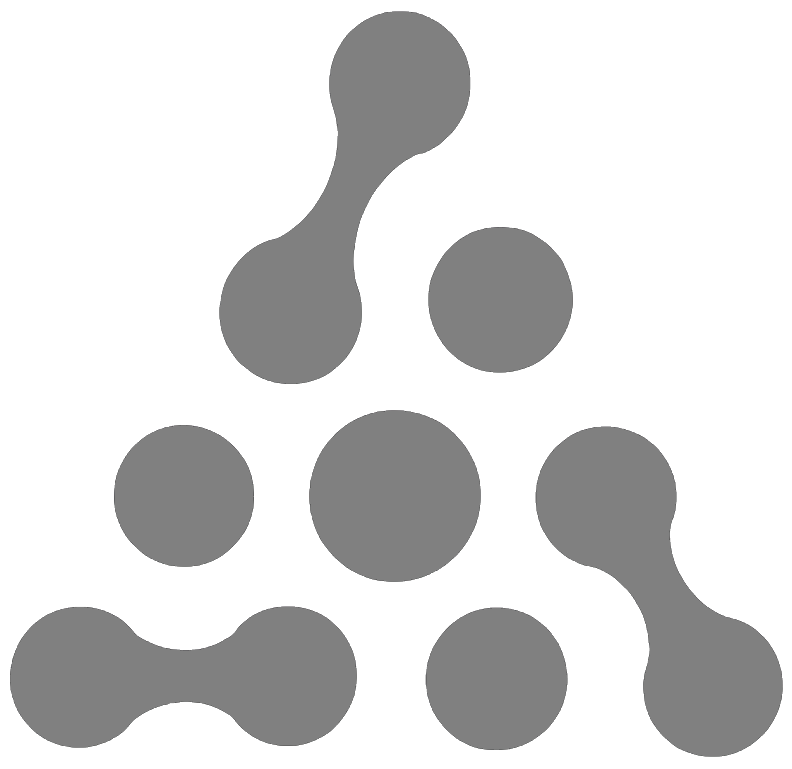

<p align="center">
  
</p>

<h1 align="center">Armada</h1>

<p align="center">
  <strong>Multi-agent orchestration for scaling human developers with AI coding captains.</strong>
  <br />
  <em>Private fork of <a href="https://github.com/jchristn/Armada">jchristn/Armada</a> — v1.0.0 — selected upstream features with fork-specific controls</em>
</p>

<p align="center">
  <a href="#why-armada">Why Armada</a> |
  <a href="#upstream-vs-fork">Upstream vs Fork</a> |
  <a href="#features">Features</a> |
  <a href="#quick-start">Quick Start</a> |
  <a href="#mcp-integration">MCP</a> |
  <a href="#architecture">Architecture</a> |
  <a href="#license-and-attribution">License</a>
</p>

---

## Why Armada

Armada is an Admiral process that coordinates AI coding agents, called captains, across registered git repositories, called vessels. It gives humans a control plane for dispatching, monitoring, reviewing, and landing agent work without losing context between repositories or terminal sessions.

Use Armada when one prompt in one shell is not enough:

- You want several captains working in parallel without sharing a worktree.
- You need missions to flow through implementation, tests, review, and landing gates.
- You want every mission, voyage, log, diff, check, incident, and release to become durable project memory.
- You need MCP and REST access so humans, dashboards, and orchestrator agents can all operate the same system.

Armada is intentionally vocabulary-heavy because the model mirrors the operating workflow:

| Concept | Meaning |
|---|---|
| Admiral | The server that schedules work, owns persistence, exposes REST/MCP/WebSocket surfaces, and manages landing. |
| Fleet | A collection of related repositories. |
| Vessel | One git repository registered with Armada. |
| Captain | One configured AI worker runtime, such as Claude Code, Codex, Cursor, Gemini, or OpenCode. |
| Mission | One atomic unit of work assigned to a captain. |
| Voyage | A batch of related missions dispatched together. |
| Dock | An isolated git worktree where a captain performs the mission. |

### Who It's For

- Developers who work across multiple repositories and want less context rebuilding.
- Teams that want auditable AI-assisted delivery instead of one-off terminal sessions.
- Operators who need durable checks, releases, deployments, incidents, and runbooks around agent-produced work.
- Orchestrator agents that need a structured MCP surface for creating, monitoring, reviewing, and landing work.

---

## Upstream vs Fork

This repository is a private fork of [jchristn/Armada](https://github.com/jchristn/Armada).
It shares the core operating model -- fleets, vessels, captains, missions, voyages,
docks, pipelines, and delivery records. It is a divergent fork with selected
upstream features and its own authorization, routing, verification and recovery
rules. Its version numbers are independent of upstream. v1.0.0 does not claim
full upstream feature parity. The incremental integration procedure lives in
[`CLAUDE.md`](CLAUDE.md).

For release changes, see the [changelog](CHANGELOG.md#v100-2026-10-26). Read the
[v1.0.0 upgrade guide](docs/UPGRADING.md) before replacing an existing server.
Docker and local publish scripts remain the supported release paths.

### Upstream adoption in v1.0.0

The selected integration pass includes these capabilities. The sections below
explain the fork behavior and link to its subsystem guides.

| Upstream capability | Included behavior |
| --- | --- |
| Password and lifecycle correctness | Salted passwords with legacy upgrade, cancellation-safe writes and interrupted Architect fan-out repair. |
| Database protection | Pre-migration backup with isolated restore verification, historical upgrade checks and per-file SQLite write queues. |
| Runtime and MCP evidence | Typed provider failures, final reply artifacts, deferred caller-filtered catalogs, bounded file reads and matching HTTP/stdio tool names. Missing standalone services return `Unavailable`. |
| Harbor execution | Capacity waits, opt-in host-owned checkouts and fenced restart adoption with verified output replay. |
| Operator workflows | Saved Ask threads with read-only MCP listing, exact human approval proposals, fork-aware work reports, checkout import, Mission actions, a read-only Harbor jobs view and a Harbor host chart. |
| Ask native tool permissions | Adapted: each Ask launch resolves a read-only native shell and file policy on its own launch copy, with an operator setting that widens it. Mission launch defaults are unchanged. |
| UI and local releases | Shared table controls on Voyages only; staged Dashboard installation with rollback and fresh-install failure checks. |
| Administrator storage inventory | Adapted: a cached, read-only, bounded scan of the data directory by category plus database size and table metadata on all four providers, a manual refresh, a bounded growth history kept in one JSON file, `GET /api/v1/storage`, `POST /api/v1/storage/refresh` and a Dashboard Storage page, all global-administrator only. Harbor runners do not report storage. See [Storage Inventory](docs/STORAGE_INVENTORY.md). Disk lifecycle cleanup is a separate feature. |
| Architect plans | Version 2 and 3 JSON contracts with an explicit integration barrier that waits for all accepted branches to land. |
| Default credentials | Adapted: a non-loopback start refuses while the seeded admin password is active, unless `ARMADA_INITIAL_ADMIN_PASSWORD` replaces it or an explicit setting allows it with a warning. The known `default` bearer token is retired once the password changes. New tenants get a supplied or generated admin password, and a self-service password change needs the current password. See [upgrading](docs/UPGRADING.md#seeded-default-credentials). |
| Login and proxy hardening | Credential logins lock an account or client address after repeated failures and return `429`. The remote proxy refuses its built-in password, persists its lockouts, requires a session for its instance list and marks its cookie `Secure` behind HTTPS. |
| Runtime and script reliability | Refinement sessions release only their own turn, a remote MCP session that returns 404 is replayed once, worktree and conflict reads are NUL-delimited, POSIX publish scripts forward their framework options, and Codex tool inventory runs on the host that executes the captain. |
| Judge restart context | Adapted: a restarted Judge whose last run ended `FAIL` or `NEEDS_REVISION` receives a capped, historical excerpt of that review to re-check against the current commit; the complete output stays in the mission's preserved runs. |
| Operational visibility | Harbor host metrics in a bounded in-memory ring, an advisory per-vessel repository health report that never blocks dispatch, and pending Ask proposals in the Needs You inbox. |
| Paged lists and typed errors | Additive: paged `POST .../enumerate` routes for jobs, the inbox, model endpoints and planning sessions beside the unchanged whole-list routes, with caller scope applied before paging. HTTP 501, 503 and 504 bodies and WebSocket `command.error` frames add a machine-readable code; existing `Error` values and statuses are unchanged. |
| Non-root containers | Opt-in only: a `runtime-nonroot` image stage and a compose override for the server and proxy. The default images stay root, and base images keep their floating tags. See [Docker](docs/DOCKER.md). |

### Upstream features not imported

| Capability | v1.0.0 decision |
| --- | --- |
| TUI and mobile app with server push | Deferred; Dashboard and Helm remain the supported clients. |
| Central CLI permission requests and rules | Requires a separate design; saved Ask approvals do not provide this tool-permission workflow. Ask launches use the fixed read-only native policy described in [saved conversations](docs/ASK_CONVERSATIONS.md#native-tool-access) instead. |
| Hosted CI workflow publication | Held. Local verification and the Linux gate remain available. |
| Signed installers, package-service publishing and A/B-slot rebuilds | Excluded from this release scope; keep Docker and local scripts. |
| Arbitrary shell Fleet Actions | Excluded; saved actions dispatch missions through existing Checks and landing rules. |
| Upstream routing, blocked-stage and recovery replacements | Keep fork Smart Routing, exact-commit verification, incidents and bounded rescue rules. |
| Upstream retention and bulk permanent deletion | Keep the fork archive and retention rules. |
| Cloud model-endpoint providers (Azure OpenAI, Vertex AI, Bedrock) | Not ported. |
| Ask pane interface refinements | Adapted in part: tool-call cards that survive a reload, server-side unread state, per-conversation drafts, a resizable conversation list, prompt history and work-card links. The per-reply copy button, the thread-list refresh control and the dispatch-first prompt are not adopted. |
| MCP tier field, typed mission and model-validation reporting, request-history filter | Deferred. |
| Upstream's other developer conveniences (workflow-profile suggestions, bulk checkout history, token heatmap, proxy-build and endpoint options, SDK and Harbor desktop) | Deferred. |
| Removal of whole-list routes and a deprecation registry | Not adopted; the whole-list routes stay beside the paged routes. |

This table records selected integration decisions. It is not an inventory of
every later upstream change. A capability present in source can also be disabled
by deployment policy. Harbor-owned checkouts remain opt-in.

### Shared capabilities and fork behavior

Both versions offer saved Ask conversations. The fork keeps the current chat
routes and administrator access rule. Saved threads belong to one tenant and
user, build model context from stored turns, and retain a durable request fence
so a retry cannot launch the same turn twice. Interrupted turns remain explicit
and block replacement. Saved-turn MCP access proposes supported changes for exact
human approval. Durable execution claims prevent replay, and work cards use recorded
landing and rescue facts. Ask turns launch CLI runtimes with read-only native shell and
file tools unless an operator widens the setting. See [saved conversations](docs/ASK_CONVERSATIONS.md).

Both versions offer saved Fleet Actions. The fork supports [Mission actions](docs/FLEET_ACTIONS.md)
through its existing dispatch, checks and landing rules. Definitions and run
snapshots belong to one operator. Durable claims prevent repeated dispatch,
and an unknown dispatch outcome stays blocked from automatic retry.

The fork's Server area includes a read-only Harbor jobs view and a host chart for
one enrolled runner. The view uses the current caller's scoped records and
separates an unavailable endpoint from an empty job list. The chart reads an
in-memory sample ring. A missing or late sample is a gap, and a stale host names
the time of its last sample. The ring is not a storage inventory and it keeps no
durable history. The [client surface map](docs/CLIENT_SURFACES.md) identifies the REST,
Dashboard, Helm and MCP entry points and their availability boundaries.

The Voyages list uses shared table controls with saved optional columns. Server
paging, status filtering and fork voyage actions keep their existing rules.
Other list pages retain their own table layouts.

Both versions use salted PBKDF2-HMAC-SHA256 password storage. The fork keeps
the SHA-256 API input and upgrades legacy rows with conditional password-only
writes, so a concurrent password reset is preserved.

Both versions refuse a non-loopback start while the seeded default admin
password or `default` bearer token is active, deactivate that token once the
password changes, and accept `ARMADA_INITIAL_ADMIN_PASSWORD` on the first start.
The fork names its override `AllowDefaultCredentialsOnNetwork`, reports the
default-password state on `whoami` and `authenticate` without blocking the
session, and keeps its strict MCP authentication and caller scopes.

Both versions seed a new tenant's admin with an explicit or one-time generated
password and require the current password for a self-service password change.
The fork applies that rule to `PUT /api/v1/users/{id}` and
`PUT /api/v1/account/password`. An administrative reset of another user, and a
request that uses the configured `ApiKey`, do not need it.

Both versions protect cancelled missions from stale full-row writes. The fork
keeps explicit status-conditioned transitions and restart to `Pending`, and stops
completion and handoff paths when they observe cancellation.

Both versions recover interrupted Architect fan-out. The fork also repairs partial
stage chains, preserves started work and holds ambiguous graphs for review. A
completion record is tied to the stored plan so a changed plan is checked again.
The fork also accepts opt-in version 2 and 3 JSON plans. Their final integration
mission uses an explicit barrier for parallel branches and starts only after
every accepted branch has landed on the current target. See
[Architect plans](docs/PIPELINES.md#structured-architect-plans).

Both versions parse Jest and Vitest test totals and Windows summary lines. The
fork keeps aggregate .NET project counts and prefers structured test artifacts
only from the current local execution; older files remain visible as artifacts.

Both versions reject an unknown shared test database provider. The fork's shared
console runner reports the configuration error before it discovers or runs tests.

Both versions protect an existing database before a startup schema upgrade.
The fork requires a provider-native backup and a verified isolated restore for
all four providers before migration begins. A failed backup stops startup.
Historical upgrade checks also restore a native v51 backup, verify linked data,
and check forward migration and a fresh driver startup on all four providers.

Both versions check REST and MCP authorization contracts. The fork checks the
registered API exposure and real MCP catalog, keeps its tenant and mission scope
rules, authenticates captain session tokens through the shared service, and
marks caller-filtered tool catalogs as private cache entries. Both versions
load large API-runtime MCP catalogs on demand. The fork selects names from
the caller-filtered catalog and keeps the same authenticated connection for
execution; small catalogs and discovery-name collisions remain eager.
Both transports list server-dependent tools with the same schemas. Standalone
stdio returns `Unavailable` when a required process service is absent, while
local record-backed tools remain available.

Both versions serialize SQLite writes through a FIFO gate shared by each database
file. The fork includes shared persistence methods, migrations, expiry deletes and live restore. Reads stay independent and existing durability settings apply.

Both versions bound default workspace file reads and provide continuation offsets.
The fork keeps strict UTF-8, workspace path checks and byte limits, and reads
all six runtime instruction filenames in full by default within those limits.

Both versions prefer final reply artifacts for stage handoff. The fork keeps
structured CLI streams and derives replies from provider completion events,
while retaining token usage, tool activity and transcript fallback.

Both versions carry typed provider failure evidence. The fork adds that evidence
to its existing quota, credit and authentication policy, keeps text fallback and
retry-time parsing, and applies the same result to routing and crash detection.

What the fork adds on top of the shared model:

- **Typed decisions.** A calibrated advisory classifier (TypeSafe Jev) behind the
  existing deterministic rules. Every configured built-in decision defaults to
  Gate; without a provider key the effective mode is Off. It only ever makes a call more conservative, never lands
  or dispatches, fails closed to the rule, and never egresses unredacted state.
  Captains get read-only tools, including prior-art retrieval
  that answers "does this already exist?" with evidence before work starts.
  Captains can also read full authorizing objectives and digest-backed output
  pages from their scoped report chain.
- **Deeper review.** Linter and Recorder pipeline stages, immutable reviewed-commit
  Checks, declared-consumer builds, verified landing evidence, and full recovery
  pipelines with provider-aware rescue.
- **Smart Routing.** Legacy Routing (captain capability tiers and preference
  ranks, persona locks and minimum tiers, non-native-first) plus an opt-in usage
  filter that removes captains on exhausted accounts and demotes low ones,
  per-persona default, lighter, and stronger model lists chosen by the
  `capacity_escalation` typed decision, and optional persona route restrictions.
  Smart Routing only reorders the captains Legacy Routing admits.
- **Operations.** An in-place Restart Server action adapted for Docker (a graceful
  stop under the container restart policy); a Voyage AI code-index embedding client;
  supervised self-deploy, hardened but disabled pending its safety integration; and
  server-side Harbor remote runners, disabled by default.
- **Repository context.** A code index, symbol graph, and context packs feed dispatch;
  a context index supplies scoped retrieval, with optional brief slimming disabled
  by default. See [Context Index](docs/CONTEXT_INDEX.md).

Both versions wait for Harbor capacity. The fork checks the explicitly routed
runner for the mission owner before it provisions a dock. A full runner leaves
the mission pending with a named hold; assignment retries when a slot is free.
The launch still checks capacity atomically and never falls back to a local run.

The fork ships a [headless Harbor console runner](docs/HARBOR_RUNNER.md) for
process-only routes. Independent job supervisors retain exact process identity
and bounded output through console reconnects; the runner resumes from the
Admiral's saved cursor without launching another agent. Checkout operations
remain on the Admiral for these routes. Opt-in
[Harbor-owned checkouts](docs/HARBOR_CHECKOUTS.md) move Git, files, checks and
landing to an explicit host repository grant. Pinned bindings and durable retry
intents retain the fork's authorization, verification and one-writer rules. An
unavailable or uncertain owner leaves a named hold.

Both versions support Harbor job recovery. The fork stores the exact mission,
captain, dock and process attempt before launch. Restart adoption requires the
same authenticated owner and enrollment, process start identity and complete
output replay. Uncertain writers retain their assignment and dock; a confirmed
terminal result is acknowledged after the mission exit handler completes.

The table above records the features outside this release scope. Supervised
self-deploy remains disabled pending its separate safety integration.

---

## Features

### Multi-Agent Work Management

Armada models work explicitly so a human or orchestrator can inspect every layer:

- Fleets group related vessels and can carry default pipeline settings.
- Vessels store repository URLs, local/bare paths, default branches, landing modes, protected paths, sibling repositories, default playbooks, and code-index settings. Global administrators can [import existing checkouts](docs/VESSEL_CHECKOUT_IMPORT.md) from configured folders while retaining the external checkout. Tenant administrators can push landing-repository branches to `origin` and merge them locally through guarded, confirmed controls that never force, delete, or bypass mission landing gates. The vessel page also shows advisory repository health. That report does not block dispatch or replace readiness, preflight, Checks, or the definition-of-done gate.
- Captains represent runnable AI workers with runtime, model, persona eligibility, state, health, and current assignment.
- Missions store the actual unit of work, status, persona, preferred model, dependencies, playbook snapshots, logs, diffs, landing state, and output.
- Voyages group missions and preserve shared title, description, vessel, objective, planning-session, playbook, pipeline, and landing context.
- Docks are per-mission git worktrees so captains work on isolated branches instead of sharing the user's checkout.

### Autonomous Scheduling And Operator Tools

The objective scheduler selects eligible objectives and dispatches captains.
Its settings persist across Admiral restarts, and its voyages use the normal
Build and UnitTest Check-arming path. On .NET vessels that path also arms a Slop
Check, which classifies the reviewed diff natively: skipped tests, project-wide
`NoWarn` and central package version bypasses fail it, and empty catch blocks,
literal delays and warning suppressions are reported without failing it. Once a
voyage has a commit under review,
an armed Check that has not run yet is queued work: the Judge gate stamps it at
the reviewed commit and holds the PASS until it runs, rather than rejecting the
PASS for missing Checks. Operators handle landing, incidents,
campaign planning, and helper requests.

`scripts/autonomy/spawn-helper.sh` provides capped, timed helpers for narrow
delegated work. `scripts/autonomy/watch-armada.mjs` subscribes to the WebSocket
hub and emits one line per voyage, mission, incident or directed note, so an
operator session watches by subscribing instead of blocking on a poll.

A sweep that dispatches nothing says why. `LastSkipReason` is null only when work
was dispatched, and otherwise names the constraint with counts;
`LastSweepSkippedObjectives` names up to 20 objectives the sweep examined and did
not dispatch, each with its reason and the preview's first error code. A prepared
objective whose verified branch moved stays ready when no changed file is one the
objective cites, claims or is assigned (`preparation_target_revision_moved`, a
Warning); a change to such a file is an Error that names it. When an operator
re-pins a preparation anchor to another commit of the same branch, a claim that
depends on that anchor needs a recheck only when the move changed a path the
claim cites (a rename or delete counts for its old path); a claim whose cited
paths are unchanged stays `Verified` and the anchor moves. A claim that cites no
path, a move whose changed files cannot be read in full, and a change of
`StartFromRef` or vessel mark every dependent claim `NeedsRecheck`. Note that an
objective must name exactly one vessel to auto-dispatch: set `VesselIds` to the
vessel whose repository receives the commit. An objective can also carry a
`StartFromRef`: the first stage's branch is cut from that ref instead of the
default branch, and a ref that does not resolve refuses the dispatch by name
(`start_from_ref_missing`) rather than falling back. Operator dispatch inherits
that objective ref unless `missions[].startFromRef` overrides it. The dispatch
result echoes resolved commits in `MissionStartRefs`, and
`mission.start_ref_resolved` records the root commit.

Use `preview_objective_dispatch` or
`GET /api/v1/objectives/{id}/dispatch-preview` before dispatch. The read-only
preview checks the target, pipeline roles, configured captains, required Checks,
repository inputs, brief, and the complete typed dependency graph. Diagnostic
paths are bounded and report when they are truncated. Role coverage asks the
rules assignment asks: the vessel's tenant, quarantine (including a future
quarantine deadline), Smart Routing persona routes, the requested captain from a
captain override or the persona's default captain with its fallback tier floor,
and the tier floor a pinned model no captain runs sets. A compatible captain
does not have to be idle for the objective to be ready; idle state is capacity.
Operator and autonomous objective dispatch use this same preflight.
The Jev text check can add blocking issues, but its Q4 dock-observability and Q13 owner-question findings are warnings. Deterministic preflight facts and recorded owner answers remain authoritative.
Question 1 resolves ordinary citations at the target repository revision: the
resolved `StartFromRef`, or the default branch tip. When the start commit is not
on the vessel's default branch (a recovery start on a mission branch whose brief
merges the branch first), a citation that fails at the start commit is read
again at the branch tip and passes when it resolves there; the fact names the
branch and commit where it resolved, and a failure names both refs it read.
Every question-1 fact names the commit it read. A citation the target does not
track resolves in the trees a dock provisions
beside it: a `../<Sibling>/...` path, or a path whose first segment is a
declared sibling's directory name, at that sibling repository's verified tip
(or under its declared extraction artifact paths); a bare file name in any
declared sibling, where a name that matches several of the sibling's files means
the one whose lines hold the citation, as in the target; and a path whose first segment names an evidence root that
applies to the vessel. A path that traverses above its root, or that names no
declared sibling or evidence root, remains unresolved. When the question-1 fact
fails only on citations outside the target repository
(`FailsOnlyOutsideTarget`) and no other fact fails, the Jev q1 reading is a
warning.
The REST preview accepts a JSON `captainAssignments` query value when an
operator must test the same captain and fallback-tier overrides as dispatch.

Every work-creation path also passes through one durable fleet-capacity gate.
The gate counts active work-bearing voyages plus standalone active missions,
uses the transitive sibling-lane map, and holds a renewable tenant-scoped lease
through initial graph creation. It reads only the vessel footprint of active
work in one database query, so its cost does not grow with retained history.
Capacity refusals use
`fleet_capacity_reached` or `sibling_lane_capacity_reached`; failed creation is
cancelled before the lease is released. Mission metadata updates cannot move a
mission between vessels or voyages, and restarts are admitted like new work.
Captain launch has its own global limit, `MaxConcurrentCaptainWorkloads`. One
global workload reservation is held from the active-workload count until the
mission is durably Assigned, so parallel assignments in different lanes cannot
both take the last slot. Voyage and sibling-lane limits keep their own leases.

### Pipelines and Personas

Built-in pipelines let work move through the right level of review:

- `WorkerOnly`: one implementation mission.
- `Reviewed`: Worker followed by Judge.
- `Tested`: Worker, TestEngineer, Linter, then Judge.
- `FullPipeline`: Architect, Worker, TestEngineer, then Judge.
- `ProductDevelopment`: Product Manager, Architect, Worker, Usability Engineer, TestEngineer, Linter, Judge, then Recorder.
- `Recorded`: Worker, then Recorder -- do the work, then record what is worth remembering.
- Specialist-tested pipelines add a domain reviewer before tests; the reference-porting pipeline also runs the Linter before the Judge.

The Judge must cite evidence for each acceptance criterion in the brief; duplicate
claims and missing criteria refuse PASS. Brief trimming preserves the criteria.
The gate reads each criterion's attached verdict; words quoted in the criterion
or its evidence do not act as verdicts.
See [Judge acceptance evidence](docs/PIPELINES.md#judge-acceptance-evidence).

A Linter stage runs before the Judge in the pipelines that produce vessel code, so overengineering and style are caught before review. `FullPipeline` stays without a Linter as the minimal review shape.

Personas are stored records, not hardcoded prompt strings. Custom personas and prompt templates can be added through REST or MCP and then referenced by custom pipeline stages.

The default TestEngineer role follows explicit objective limits on test changes.
A documentation-only or no-test scope does not require new test files; the stage
still runs validation that the objective requires and permits, and reports
remaining risk. Database templates and project-profile overrides retain their
normal precedence over the embedded persona.

### Model-Tier Routing

Dispatchers can use `preferredModel` as routing guidance. Routing
selects in three layers; see [Smart Routing](docs/USAGE_ROUTING.md).

- Each captain carries a capability tier (`Economy`, `Standard`, `Premium`; classified from the model name unless pinned) and a preference rank, both edited on the captain. `low`, `mid`, and `high` name a tier floor (Economy, Standard, Premium): the lowest idle tier at or above the floor is tried first, higher rank first.
- A persona can set a minimum capability tier. The Test Engineer persona uses a Standard minimum so routine test work can use Standard captains.
- Literal model names remain available for direct pins.
- Pipeline stages can override mission-level routing with their own `PreferredModel`.
- Dispatch and objective preview use the same persona-aware result for each generated
  stage and mission. The persona minimum and mission request combine into one
  floor. Preview reports separate
  requirements when mission descriptions use different literal model pins.
- Non-native-first, reserved Premium slots, and the stage-persona title-prefix guard live in `ArmadaSettings` (`factory/settings.fleet.example.json` is the fleet overlay). The retired tier keys move onto captain tiers, captain ranks, and persona minimum tiers once at startup, with a settings backup.
- **Legacy Routing** is everything above, with `modelTier.usageRouting.enabled` false. It needs no Jev key and remains available when operators prefer its deterministic order. Optional [Smart Routing](docs/USAGE_ROUTING.md) (`enabled` true) keeps the Legacy Routing order and filters it: captains on Exhausted accounts are removed and captains on Low or Reserve accounts move after the rest. Per-persona `default`, `lighter`, and `stronger` model lists group the order, the `capacity_escalation` decision chooses the list tried first, and optional persona routes restrict a persona to named accounts. Without Jev, Smart Routing tries Default first and keeps the account usage filter. The Dashboard Settings hub’s Routing tab supports account usage, reserve thresholds, budget planning, and draft previews. Collectors support Codex, Claude, Cursor, OpenCode Go, and normalized local snapshots. An account can own a separate captain login for Claude Code, Codex, OpenCode, or Cursor; it is off unless configured, and a provider limit on one captain holds its whole account. A logged-out, expired, or held account blocks assignment with a named reason code in status and the usage preview.
- The same Routing tab edits those fields and saves only the fields that changed. `modelTier` and `voyageDispatch` hot-reload; `modelProviders` and additional personas/pipelines/templates load at startup.

### Typed decisions (Off until a key is present)

A calibrated classifier (TypeSafe Jev) the admiral can consult at a decision
point, behind the deterministic rules it never replaces. Without a provider key
the effective global mode is `Off` (reason `typed_decisions_no_key`), whatever
the stored mode. With a key, each decision ships in `Gate`, except the nine the
owner switched off after the observation review, which ship `Off`; a decision
that runs records the rule's verdict and the model's on every call. The key comes from the environment
variable named by `apiKeyEnv`, or from the key file
`<data directory>/secrets/typesafe-api-key` that `PUT /api/v1/typed-decisions/key`
writes; adding or removing it takes effect without a restart. The decision
catalogue and its principles are documented in
[Typed decisions](docs/TYPED_DECISIONS.md).
When a decision is enabled it can only make a call
more conservative, never lands or dispatches, gates only at or above the
confidence threshold, fails closed to the deterministic rule, and never egresses
unredacted state. Captains can consult read-only tools
(`armada_typed_decision`, `armada_score_items`, `armada_check_premise`, `armada_check_prior_art`,
`armada_memory_triage`). Configure it under `typedDecisions` in `settings.json`:

| Key | Default | Meaning |
| --- | --- | --- |
| `mode` | `Gate` (effective `Off` without a key) | Global cap and kill switch: `Off`, `Shadow`, or `Gate`. `Off` stops every decision point and every captain tool. Hot-reloaded. |
| `baseUrl` | `https://api.typesafe.ai` | Provider base URL; the client POSTs to `{baseUrl}/v1/systemone`. |
| `model` | `jev-latest` | Model id sent with each request. |
| `apiKeyEnv` | `ARMADA_TYPESAFE_KEY` | Environment variable holding the Bearer key. When unset, the key file `<data directory>/secrets/typesafe-api-key` is read. The key is never stored in settings. |
| `timeoutSeconds` | `10` | Per-request timeout; a slower decision is unavailable, not late. |
| `maxStateChars` | `60000` | Character cap on redacted state per request, about 20,000 provider tokens. A batch also stays under 80,000 characters of state plus question text, inside the provider's 32,000-token request limit. |
| `egressExcludedMarkers` | empty | Text markers meaning a state carries content that must never leave the host (for example a directory of decrypted vendor data). Checked on the UNREDACTED state by every egress path - the adapter skeleton, the standalone adapters, custom decisions and captain tools. A decision's or custom definition's own `egressExcludedMarkers` replaces this list for it; an empty own list opts it out. A match sends nothing and records `egress_excluded_content`. |
| `egressExcludedVesselIds` | empty | Vessels whose content must never leave the host. Every decision about an objective, mission or vessel that names one of them keeps its rule, sends nothing, and records an unavailable event with reason `egress_excluded_vessel`; an objective names its `VesselIds`. |
| `decisions` | all `Gate` | Per-decision `mode` (`Off`/`Shadow`/`Gate`) and `gateThreshold`. Effective mode is the minimum of the global and per-decision mode. |
| `evalOnModelChange` | `true` | Run the synthetic evaluation set in the background when the provider reports a model version not yet evaluated. |
| `captainTool` | enabled | Captain-facing tool: `enabled`, `maxStateChars` (default `60000`). There is no per-mission call cap. |
| `retention` | off | Host-local retention of REDACTED decision state as training data: `enabled`, `retentionDays`, `minimumSamplesPerDecision`, plus `retainState` per decision. Nothing leaves the host and no event carries the state. |

Without a key no decision calls a client or records an event. `mode` and
`decisions` hot-reload in place, so decision points see the change and a later
settings write cannot clobber it. `GET /api/v1/typed-decisions` reports the
effective and stored modes, key presence and source, and every decision;
`PUT /api/v1/typed-decisions` changes modes and thresholds. Every enabled call emits a
`typed_decision.gated`, `typed_decision.shadow`, or `typed_decision.unavailable`
event carrying the decision, verdicts, confidences, tokens, latency, and the
state's hash and byte count — never the state itself. See
[Typed decisions](docs/TYPED_DECISIONS.md) for the full
contract.

### Runtime reply handoff

Local Claude, Cursor, Gemini and OpenCode launches can publish a final reply file
after output drains and the process exits successfully. Claude and Cursor use
their successful terminal result. Gemini uses the last assistant turn after its
last tool call and a successful result. OpenCode uses completed text-part
snapshots and requires a matching final stop step with no later structured event.
A missing completion keeps transcript fallback. Captured text keeps its last
524,288 UTF-16 characters; OpenCode retains at most 128 recent text parts within
that limit. Tool output, reasoning and JSON envelopes are excluded.

An existing reply file is preserved. Publication uses a complete
temporary file and never replaces an existing target. Failed runs and blank
replies write no file. The mission lifecycle reads the file before transcript
output and removes it after use. Harbor launches retain their existing transcript
handoff.

### API-endpoint tools and compaction

The `ApiEndpoint` runtime runs its workspace tools and holds the conversation in
process. Harness captains keep their harness's own tools and compaction; Armada
ships no harness plugin. These are shape rules, not typed decisions.

- `run_command` starts bash as the leader of its own process group (through
  `setsid`, or `perl` where `setsid` is absent). A timeout or a cancellation kills
  the whole group, including a background child the shell left behind. On Linux
  a descendant that starts its own session and leaves the tree is killed too,
  through the run identifier it inherits; on macOS it escapes, and on Windows
  only the live tree is killed (see "Child processes"). Output is
  read in fixed-size chunks, so a line longer than the cap is cut while it is read.
- `read_file` defaults to at most 200 numbered lines and 24,000 characters,
  with a continuation offset. An explicit positive `limit` selects a range;
  `limit=-1` requests the remaining file. `CLAUDE.md`, `AGENTS.md`, `CODEX.md`,
  `CURSOR.md`, `GEMINI.md` and `MUX.md` default to complete reads. Existing input
  and output byte limits apply to every read.
- `edit_file` and `multi_edit` refuse empty `old_string`. Each `multi_edit` step
  must match exactly once in the content the earlier steps produced. An ambiguous
  match reports its count and at most 20 candidate lines.
- Large `run_command` output is pruned inbound before it enters the conversation.
  Past about 10,000 estimated tokens, progress-only chunks (download, compile,
  cache, test progress dots) may drop. Diagnostics, test totals, JSON/XML/YAML,
  diffs, source dumps and binary blobs stay. The full output is archived at
  `.armada-tool-output/` in the workspace and cited on the result. A failed
  archive leaves the original output.
- When the conversation crosses about 1 MiB, older tool results keep a
  300-character head plus a `[compacted]` marker. Diagnostic and test-total
  lines stay. The conversation never drops a message, so tool-call and
  tool-result pairing stays intact.
- Past a hard ceiling of 8 MiB the same pass truncates remaining large results,
  including diagnostics. A conversation that still exceeds the ceiling fails the
  run.
- Each pass that replaces a result records a `mission.context_compacted` event
  on the mission. Its payload gives the replaced count, the conversation size
  before and after, the removed bytes in total and per tool, and whether it was
  the hard-ceiling pass. The record travels outside the output stream that
  terminal markers and verdicts are parsed from.

Anthropic API endpoints request a five-minute cache breakpoint on the fixed
launch message. This caches the tools, system prompt, and launch prefix when
the provider minimum is met. Later messages do not move that breakpoint. Other
transports log once that explicit breakpoints are unavailable; automatic
provider caching may still apply. Cache reads, cache writes, and reasoning
tokens are copied from provider usage into runtime usage events. A zero counter
is not proof that a request was eligible for caching.

A 2026-09-19 census of 1,129 real Claude Code sessions found zero
`compact_boundary` events, so no Bash `tool.call` hook ships.

### Code Index, Context Packs, and Graph Search

Armada owns a repository code index for dispatch-time retrieval:

- The dashboard Code Index page at `/code-index` shows index status and searches
  the selected vessel. It lists every vessel and reports an unavailable index
  with its reason. Search and status responses stay with the selected vessel.
- `armada_code_search` searches indexed chunks for a vessel.
- `armada_context_pack` builds dispatch-ready markdown and returns a prestaged `_briefing/context-pack.md`.
- `armada_fleet_code_search` and `armada_fleet_context_pack` retrieve across a fleet.
- Graph tools search symbols, callers, callees, impact, and affected tests from sidecar files.
- Hybrid search can combine lexical and semantic ranking when semantic search is enabled. Semantic embeddings use a Voyage AI client (`voyage-code-3`); supply the embedding key from the environment to enable live indexing.
- Context packs are attached automatically during architect decomposition and on every dispatch
  path that creates captain work: operator dispatch (REST and MCP), the autonomous objective
  scheduler, and autonomous rescues (whose later stages read the Worker's pack). Each mission's pack
  is built for that mission's own goal (its code-context query, or its title and description), with
  the files its brief names and its start ref. When the full goal pack fails or times out, dispatch
  stages a lexical-only pack for the same goal, which reads only the local index (no query embedding,
  graph expansion or summary), and logs `lexical_goal_pack` with the reason. The vessel's baseline
  pack, cached for the generic goal "codebase architecture key types and responsibilities", is never
  staged for a mission.
- A pack puts the files the mission names under `## Assigned files`, ahead of ranked evidence.
  Ranked evidence follows only when a chunk touches an identifier or file the mission names; when
  nothing in the index does, the pack holds one `No relevant indexed chunk:` line instead of
  unrelated prose. Every pack header names its goal, the indexed commit (`Indexed commit`, which the
  related evidence and the assigned files taken from the index reflect), the start commit of the
  mission checkout (`Start commit`, which the assigned files marked as read at the start commit
  reflect), the start ref, a `Commit check:` line that states whether the indexed commit is the
  start commit, the covered roots, the assigned files (found and not found), and any `../` sibling
  inputs the brief names, which a single-vessel pack does not hold. When the indexed commit differs
  from the start commit, an assigned file that changed between them is read from the local
  repository at the start commit (a local `git show`; nothing is embedded or summarized), and a
  related chunk whose file changed between them is marked as possibly out of date. A summarized pack keeps the header
  and the assigned files above the summary. The captain brief tells the captain to record a pack
  that misses files in the report's `Pack:` line, not as a papercut.
- A mission whose pack is not staged is never skipped in silence: its description gains a
  `Context pack: not staged. Reason: ...` line that the captain quotes in its `Pack:` line, and a
  `code_context.not_staged` event records the vessel, the dispatch path and the reason.
- Search and context packs never create an index. On a vessel that has never been indexed, vessel search returns `Available: false` with `UnavailableReason: not_indexed`, fleet search and fleet packs list the vessel in `NotIndexedVesselIds`, and a context pack stages no file. Nothing from that vessel reaches the embedding provider. An `auto` dispatch then proceeds without code context and records the not-staged reason, even when `codeIndex.requireContextPackWhenEnabled` is set; a `force` dispatch fails and names the reason. The scheduler and rescue paths never refuse for a missing pack; they record the reason.
- Only an explicit index update (`armada_index_update` or the REST update route) indexes a vessel for the first time. Automatic refresh (after a landing, from the merge queue, from a stale-index dispatch, and from the staleness sweep) refreshes an already-indexed vessel in the background and never indexes a new one.
- A failed index update reports `Freshness: Error` with `LastError` and keeps the last successfully indexed commit, so the vessel stays enrolled and the staleness sweep still compares it.
- Index status reports lexical freshness (`Freshness`) and semantic completeness (`EmbeddingState`, `EmbeddedChunkCount`, `MissingEmbeddingCount`, `EmbeddingDimensions`) separately. Vectors belong to one embedding provider (model, endpoint and vector length): a provider change replaces every vector, including those on unchanged files, and an update on the same commit retries chunks whose embedding failed while it reuses the valid vectors.

### Merge Queue and Automated Landing

Armada can leave work for manual inspection or land it through configured modes:

| Mode | Behavior |
|---|---|
| `MergeQueue` | Enqueue work, create a temporary integration worktree, run validation, push, reconcile, and clean up branches sequentially per vessel and target branch. |
| `LocalMerge` | Merge the mission branch in a detached integration worktree, advance the local target branch by compare-and-swap, and sync the configured working directory, without pushing to origin. |
| `PullRequest` | Push the branch and open a PR/MR; the mission remains `PullRequestOpen` until the PR is merged. |
| `None` | Stop at `WorkProduced`; the branch remains available for manual integration. |

Landing features include auto-land predicates, protected-path checks, convention and critical-trigger gates, PR fallback, target-branch-drift retry, durable landing jobs, restart recovery, branch cleanup policies, pull-request reconciliation, and merge-queue purge/cancel tools.

When a mission branch already matches its merge-queue target, an implementation
mission must have a recorded delivery commit and reachable branch history with
a commit made strictly after its start time. Missing start time or unreadable
history refuses the no-op landing. Review stages and rescues with no substantive
work remain refused.

The dashboard Notifications page at `/notifications` shows notification history
and provides read and clear actions. The legacy `/token-usage` path redirects to
`/activity?source=tokens`.

### Structured Delivery Operations

Armada is not only a captain launcher. It also keeps delivery records connected to the work:

- Objectives and backlog items track scope, priority, effort, acceptance criteria, non-goals, rollout constraints, owners, tags, and evidence links.
- Planning and backlog-refinement sessions preserve captain-backed scoping conversations before dispatch.
- Workflow profiles define build, test, package, deploy, rollback, smoke-test, and health-check commands.
- Check runs persist structured validation output and can import external CI results.
- Releases collect linked voyages, missions, checks, notes, versions, tags, and artifacts.
- Release shipping can notify an external CD system through an authenticated webhook (`cdWebhook`), with bounded retries, per-release delivery history, and a synthetic-payload test tool.
- Deployments support approval, execution, verification, and rollback records.
- Incidents track operational issues, hotfix handoff, evidence, mitigation, and closure.
- Runbooks provide guided operational procedures with execution history.
- The historical timeline correlates objectives, planning, dispatch, checks, releases, deployments, incidents, events, merge activity, request history, and runbook execution.

### Captain Health and Quarantine

The Admiral tracks captain state and health so a busy fleet remains debuggable:

- Captains move through idle, assigned, in-progress, planning, stopped, quarantined, and failure states.
- Health checks reclaim stale captains and docks after restarts.
- [Full Research replay](docs/PIPELINES.md#full-research-attempt-replay) lets an owner operator archive a failed six-stage attempt and repeat all original duties on the same voyage, with immutable source and separate historical reports.
- Diagnostics report active mission timing, dock git status, uncommitted files, launch/log hints, and code-index freshness.
- Quarantine and lifecycle controls prevent unhealthy captains — including those hitting provider quota or usage limits — from repeatedly taking work until an operator or reset window intervenes.
- Stop, recall, stop-all, and emergency controls are exposed through MCP, REST, dashboard, and WebSocket flows. Stop-all, deletion, and restart apply one shared rule on every interface: stop-all covers working captains and planning and refinement sessions and reports each failure; deletion refuses busy captains and removes the captain's events and sessions; restart keeps the captain record and resets only its runtime state.

### Playbooks and Persistent Memory

Playbooks are reusable markdown guidance that can be delivered inline, referenced, or attached into the worktree. Fleet, vessel, persona, captain, voyage, and per-mission selections merge into mission playbook snapshots so every captain receives the guidance that applied at dispatch time.

The built-in `Recorder` persona reviews the finished work of a voyage and records what is worth remembering. It is seeded and available: the `Recorded` pipeline runs it after a Worker, and `ProductDevelopment` ends with a Recorder stage. Every other built-in persona is told to recall existing memory before it acts.

Native captain memory keeps what earlier work learned: a vessel fact, a prior finding, or a procedure worth repeating, classified as episodic, semantic or procedural, with provenance, tags and a salience that orders recall. A stable key makes recording the same finding twice correct one record instead of scattering copies. Manage it over MCP (`search_memory`, `get_memory`, `create_memory`, `update_memory`, `delete_memory`) or REST (`/api/v1/memories`). Where a fleet keeps a shared external memory repository, that repository stays the authority for accepted rules and wins over a native record on conflict.

### Interfaces

`armada_search_context` reads applicable external guidance, native memory and
existing vessel code indexes in one local query. Required guidance remains
separate from ranked recall. It uses the configured database. With a pinned
local embedding endpoint it also ranks guidance and facts by meaning; it never
sends that text to a hosted provider. See [unified retrieval](docs/CONTEXT_INDEX.md#unified-retrieval-and-the-armada_search_context-tool)
for scope, limits and the remaining migration work.

Generated persona and brief instructions use this shared query. Compatibility
recall tools remain callable and share a durable mission budget. Their counters
survive restart and cannot be reset by a normal mission update.

Armada exposes the same operating model through multiple surfaces:

- REST API for dashboards, scripts, and external services.
- MCP HTTP endpoint for orchestrator agents.
- MCP stdio command for clients that prefer local framed or stdio transport.
- WebSocket events for live dashboard updates.
- Helm CLI for setup, config, server start, and MCP installation.
- React/Vite dashboard for operators.

### Persistence

Armada persists state through database drivers for SQLite, PostgreSQL, MySQL, and SQL Server. Missions, voyages, captains, docks, events, playbooks, pipelines, objectives, checks, releases, deployments, incidents, runbooks, request history, and merge-queue records are stored outside agent sessions so the system can recover, audit, and resume.

**Deployment note:** The active Armada server uses PostgreSQL. A file named
`armada.db` is a SQLite example or test artifact; it is not the database used
by the active server. Confirm the configured database type before inspecting or
deleting any database-looking file.

### SQLite write ordering

SQLite writers enter one process-local FIFO gate for the opened database file.
Driver instances, relative paths and file URI aliases share its gate. Each
transaction holds its turn through commit or rollback. Cancellation removes a
queued write, and a failed write releases its turn. Reads and writes to other
files remain independent. Other database providers use their own concurrency.

Startup holds a turn through schema migration. Expiry completes verified archive
export and trace recording before each delete queues for a turn. Live restore holds the target's
turn from its safety backup through replacement. Driver disposal leaves other
users of the same file active. Gate records use weak references with periodic
cleanup; SQLite retains its existing cross-process locking and durability.

---

## Quick Start

### Prerequisites

- .NET 10.0 SDK.
- Git.
- At least one supported agent CLI if you want local captains: Claude Code, Codex, Cursor, Gemini, or OpenCode.
- Optional for pull requests: `gh` for GitHub or `glab` for GitLab.

### Build

```bash
dotnet build src/Armada.sln
```

### Start the Admiral

```bash
dotnet run --project src/Armada.Server --framework net10.0
```

Default local endpoints:

- REST and dashboard: `http://localhost:7890`
- MCP Streamable HTTP: `http://localhost:7891/mcp`

### Configure MCP Clients

The repository includes an MCP config that points at the default HTTP endpoint.
The endpoint refuses a request without a credential, so each client entry must
send one. Read it from the environment rather than writing the key into a file:

```json
{
  "mcpServers": {
    "armada": {
      "type": "http",
      "url": "http://localhost:7891/mcp",
      "headers": { "X-Api-Key": "${ARMADA_API_KEY}" }
    }
  }
}
```

Helm can install managed MCP entries for supported clients:

```bash
dotnet run --project src/Armada.Helm --framework net10.0 -- mcp install
```

### Dispatch a Voyage Through MCP

`armada_dispatch` requires a top-level `vesselId`. Put `preferredModel` on each mission that needs routing guidance.

```json
{
  "title": "Improve status health output",
  "description": "Make the health endpoint easier for operators to inspect.",
  "vesselId": "vsl_example123",
  "pipeline": "Reviewed",
  "codeContextMode": "auto",
  "missions": [
    {
      "alias": "worker",
      "title": "Add concise health details",
      "description": "Update the status health response and dashboard copy. Keep the change focused and run the relevant build or smoke check.",
      "preferredModel": "mid"
    },
    {
      "title": "Review health details",
      "description": "Review the worker diff for correctness, regressions, and missing validation.",
      "dependsOnMissionAlias": "worker",
      "alias": "review",
      "preferredModel": "high"
    }
  ]
}
```

For dependency aliases, assign `alias` to the upstream mission and reference it from `dependsOnMissionAlias` on the downstream mission:

```json
{
  "title": "Two-stage implementation",
  "vesselId": "vsl_example123",
  "missions": [
    {
      "alias": "worker",
      "title": "Implement the change",
      "description": "Make the code change and commit it.",
      "preferredModel": "mid"
    },
    {
      "alias": "judge",
      "title": "Judge the change",
      "description": "Review the implementation and emit a verdict.",
      "dependsOnMissionAlias": "worker",
      "preferredModel": "high"
    }
  ]
}
```

### Run on system startup

To keep the Admiral running across reboots, use the scripted startup workflow. It publishes
`Armada.Server` into `~/.armada/bin`, deploys the dashboard, registers a platform service
definition, and verifies health on boot. Full guide:
[docs/RUN_ON_STARTUP.md](docs/RUN_ON_STARTUP.md).

Install the local deployment:

| Platform | Install | Update | Health check |
|---|---|---|---|
| Linux (`systemd --user`) | `scripts/linux/install-systemd-user.sh` | `scripts/linux/update-systemd-user.sh` | `scripts/linux/healthcheck-server.sh` |
| macOS (`launchd`) | `scripts/macos/install-launchd-agent.sh` | `scripts/macos/update-launchd-agent.sh` | `scripts/macos/healthcheck-server.sh` |
| Windows (scheduled task) | `scripts/windows/install-windows-task.bat` | `scripts/windows/update-windows-task.bat` | `scripts/windows/healthcheck-server.bat` |

Run the install script once, then use the update script after each rebuild to republish the
server and restart the service. The health-check helper verifies the dashboard responds.

#### Behind an enterprise proxy or firewall

If npm fails with `SELF_SIGNED_CERT_IN_CHAIN` on an SSL-inspecting corporate
proxy, add `--insecure` (or `-k`) to the install or dashboard-deploy script so
that run disables strict TLS checks for npm/Node only. Example:
`scripts/macos/install.sh --insecure` or
`scripts\windows\install.bat net10.0 --insecure`. Put the framework first on
Windows, then the flag. `dotnet` and NuGet still use the OS certificate store.
The same scripts deploy the committed `src/Armada.Dashboard/dist/` when Node.js
is not installed. Install, update, reinstall, publish-server, MCP, and
dashboard-deploy scripts honor `--insecure`. Prefer not to pass the flag each
time: set `NODE_TLS_REJECT_UNAUTHORIZED=0` (`set` on Windows, `export` on
Linux/macOS) in your shell, or run `npm config set strict-ssl false` once.

Local server publish requires an available Dashboard. If Dashboard deployment
fails, publish continues with a warning only if `~/.armada/dashboard/index.html`
still exists.
Without that file, publish returns a failure.

---

## MCP Integration

The primary MCP transport is HTTP JSON-RPC at:

```text
http://localhost:7891/mcp
```

Armada uses the official MCP C# SDK and supports the stateless MCP
`2026-07-28` protocol as well as legacy initialization-based clients. The
former `/rpc` path remains available as a compatibility alias.

To add Armada to Claude Code manually instead of using `armada mcp install`,
register its default HTTP MCP endpoint (`http://localhost:7891/mcp`):

```bash
claude mcp add --transport http --scope user armada http://localhost:7891/mcp \
  --header "X-Api-Key: ${ARMADA_API_KEY}"
```

Every MCP request must carry a credential; a request without one gets `401`.
`armada mcp install` writes each HTTP client entry with an `X-Api-Key` header
that reads `ARMADA_API_KEY` from the client's environment, so set that variable
before starting the client. No key is written to a configuration file. `docs/MCP_API.md` covers caller rules, the
captain launch credential and the SSH bridge.

Drop `--scope user` to add it for the current project only; substitute your
port if you changed `McpPort`. On enterprise-managed Claude Code this may fail
with `not allowed by enterprise policy` — that restriction is set by your IT
administrator (Claude Code's `allowedMcpServers` managed setting) and cannot be
overridden locally. See [docs/MCP_API.md](docs/MCP_API.md#transport) for the
managed-settings snippet and alternatives.

Common MCP tool groups:

- Fleet, vessel, captain, mission, voyage, dock, signal, event, persona, prompt-template, and pipeline enumeration.
- Dispatch, architect decomposition, mission status, voyage status, logs, diffs, and status transitions.
- Merge queue enqueue, process, retry, cancel, purge, and PR reconciliation.
- Code index status, update, search, context pack, fleet context pack, graph symbols, callers, callees, impact, and affected tests.
- Objective/backlog CRUD, refinement, planning, dispatch linkage, and the autonomous objective scheduler.
- Check run, release, deployment, incident, and runbook operations.
- Playbook management and mission playbook snapshots.
- Captain diagnostics, quarantine controls, AgentWake registration, long-running-job status, and directed wake delivery.

Send `X-Armada-Participant: <participantKey>` on MCP requests to receive pending
board mail appended to any tool result. A session that sends no header is
anonymous and receives none, so one session cannot read another's mail. Long
broadcast notes on a board read come back previewed; notes addressed to the
caller and unread wakes are always whole.

Discover live tool descriptions and input schemas with `tools/list`. Follow
`nextCursor` until it is absent. The complete operator workflow and current
catalog are in [`docs/armada-ops.md`](docs/armada-ops.md); transport behavior
is in [`docs/MCP_API.md`](docs/MCP_API.md).

---

## REST and Dashboard

The Admiral server exposes REST routes under `/api/v1/*`, serves the dashboard from the same HTTP server, and broadcasts live state through WebSocket. REST and MCP share the same database-backed services, so operators can mix dashboard workflows, scripts, and orchestrator-agent calls without splitting state.

Dashboard reads retry a dropped connection up to twice within the request's
deadline. The deadline includes response-body reads. Writes are not retried.
The home dashboard keeps its last data after a failed refresh and shows each
failed read with a Retry button. Chat and log streams do not reload the home
dashboard. Relevant record changes and reconnects refresh it.
Ask Armada retains questions and partial replies after a connection failure
and marks the result as unconfirmed, so the operator can check before resending.

Useful REST areas include:

- `/api/v1/status`
- `/api/v1/fleets`
- `/api/v1/vessels`
- `/api/v1/captains`
- `/api/v1/missions`
- `/api/v1/voyages`
- `/api/v1/merge-queue`
- `/api/v1/objectives`
- `/api/v1/objectives/{id}/dispatch-preview`
- `/api/v1/check-runs`
- `/api/v1/releases`
- `/api/v1/deployments`
- `/api/v1/incidents`
- `/api/v1/runbooks`
- `/api/v1/events/token-usage` (authoritative per-runtime/model token telemetry)
- `/api/v1/token-usage/summary` (bucketed token usage; input is split into uncached, cache-read and cache-write
  tokens for every runtime, and rows stored before that split are reported apart under the legacy rule)

Every route authorizes the caller as a global administrator, a tenant
administrator or an ordinary user; `docs/REST_API.md` holds the full
authorization matrix. A tenant administrator manages its own tenant's users and
credentials but never a global administrator or a protected user, and only a
global administrator and a credential's own user read its bearer token.
Stopping or restarting the server requires a global administrator unless a
deployment sets `RequireAuthForShutdown` to `false`.

A new database seeds the admin `admin@armada` with a published default password
and a `default` bearer token. These work only on a loopback listener: the
Admiral refuses to start on any other `rest.hostname` while either is active,
unless `AllowDefaultCredentialsOnNetwork` is `true` (a warning is logged at every
start). `ARMADA_INITIAL_ADMIN_PASSWORD` sets the admin password on the first
start, and changing that password through `PUT /api/v1/account/password`
deactivates the `default` token. MCP keeps its strict authentication and caller
scopes in every case.

---

## Architecture

```text
src/
  Armada.Core       Domain models, settings, database drivers, services, code index, and interfaces
  Armada.Runtimes   Runtime adapters for Claude Code, Codex, Cursor, Gemini, OpenCode, Mux, and the in-process ApiEndpoint loop
  Armada.Server     Admiral REST/MCP/WebSocket server, orchestrators, and dashboard host
  Armada.Helm       CLI for config, server start, and MCP setup
  Armada.Dashboard  React/Vite operator dashboard
```

The server constructs most services directly in `ArmadaServer.cs` and runs the fork's background orchestrators (objective scheduler, automatic check runs, autonomous recovery, incident lifecycle, code-index refresh) off the health loop. Periodic maintenance on that loop (data expiry, disk reconciliation, branch cleanup) runs one isolated step at a time, so a failing step cannot skip the others. Database drivers cover SQLite, PostgreSQL, MySQL, and SQL Server. Runtime adapters implement the shared captain process contract while preserving each CLI's launch and environment requirements. The `ApiEndpoint` adapter runs an in-process tool loop and applies a deterministic prune and truncate-head to that conversation.

Every short-lived child process the admiral starts (git, `gh`/`glab`, `docker`, version and `command -v` probes, check, gate and merge-queue test commands, AgentWake agent runs, and the `run_command` tool), and each Helm `server start` build step, runs through one bounded runner in `Armada.Core`. It reads both output streams at once, so a child that fills one pipe while the other is open never blocks. Each stream keeps a per-call byte budget; past it the result keeps the beginning and the end and names the omitted bytes. A timeout and a caller cancellation both kill the live process tree, and the readers get a bounded drain window after exit or kill, so a background child holding a pipe cannot hang the call. Callers that run arbitrary shell commands (`run_command`, check and Definition-of-Done gate commands, merge-queue test commands, and the workspace exec route), AgentWake agent runs, self-deploy native commands and Helm build steps also start the command as the leader of its own process group on Linux and macOS (through `setsid`, or `perl` where `setsid` is absent), and the kill signals that whole group, so a background child still dies after its shell has exited. The executable is resolved first, in the order `Process.Start` uses; one that is missing or not executable starts without the group, so it fails to start exactly as it does without one. On Linux a group-owning run also sets a run-unique `ARMADA_CONTAINMENT_ID` in the command's environment (a run inside a run appends its own identifier after a colon). After the group and tree kill, the runner reads `/proc/*/environ` for processes of the same real user and kills every one that carries the identifier, so a descendant that called `setsid` or `setpgid` and left the tree (a double fork, or a subshell that exits) dies too. The sweep never signals a process without the identifier or owned by another user, repeats until a pass finds no new carrier (at most four passes within two seconds), and names what it killed, what it could not read, and why it stopped early in the run's anomalies. A normal exit kills nothing. The other callers (git, `gh`/`glab`, `docker`, probes) rely on the tree kill alone and carry no identifier.

Containment of a timed-out or cancelled group-owning run, by platform:

| Platform | Live tree | Background child whose parent exited | Descendant that left the tree and the group | Remaining gap |
|---|---|---|---|---|
| Linux | killed | killed (process group) | killed (`ARMADA_CONTAINMENT_ID` sweep) | a descendant that execs with the variable removed from its environment, or that makes itself non-dumpable so the kernel hides its environment (counted as `containment_unreadable`) |
| macOS | killed | killed (process group) | survives | macOS does not show another process's environment to an unprivileged caller, so there is no sweep |
| Windows | killed | survives | survives | no process group; a Job Object is not used |

Git runs with terminal, credential-manager and pager prompts off; network git (fetch, push) uses the git timeout (`ARMADA_GIT_TIMEOUT_MS`, default 120 s). Long-lived and two-way processes (captain runtimes, OpenCode servers, MCP stdio sessions, the self-deploy host) keep their own supervision; the OpenCode server's two output streams are still read at once into the same per-stream byte budget, so a daemon's output is never held whole.

---

## Build and Test

Build the solution:

```bash
dotnet build src/Armada.sln
```

Run test projects on .NET 10:

```bash
dotnet run --project test/Armada.Test.Automated --framework net10.0
dotnet run --project test/Armada.Test.Unit --framework net10.0
dotnet run --project test/Armada.Test.Runtimes --framework net10.0
dotnet run --project src/Test.Automated/Test.Automated.csproj --framework net10.0
```

The last command runs the shared suites in `src/Test.Shared` and lists every skipped case with its reason; see [Testing](docs/TESTING.md#shared-suite-runner).

`scripts/macos/run-tests.sh` (or `scripts/linux/run-tests.sh`) runs all four at once, with the unit runner split into shards, and prints one combined result; see [Testing](docs/TESTING.md#sharded-unit-runs).

Dashboard asset changes require:

```bash
npm.cmd run build
```

from `src/Armada.Dashboard`.

---

## License and Attribution

Armada was created by [jchristn](https://github.com/jchristn) as [`jchristn/Armada`](https://github.com/jchristn/Armada). This repository is a private fork that builds on that work; all upstream copyright and attribution are retained.

Armada is licensed under the terms in [LICENSE.md](LICENSE.md).
